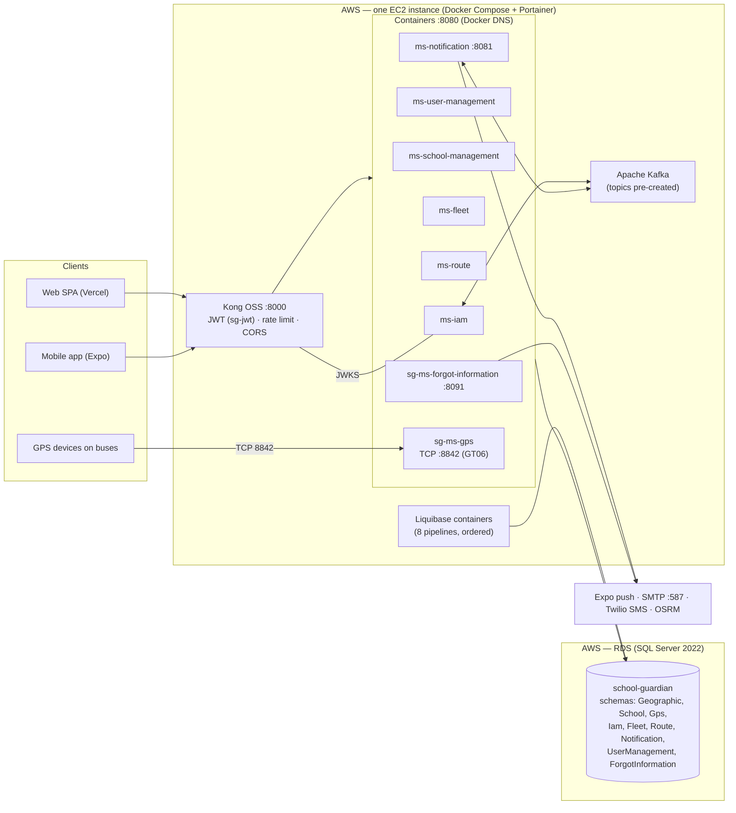

# Deployment view

Last updated: 2026-10-22 · Complements [overview.md](./overview.md) (C4) and `10-devops/`

## Real environment (AWS)

The application flow runs on an **AWS EC2** instance (Docker Compose, administered with
Portainer) and the relational model lives on **AWS RDS** (SQL Server). The relational model
is the source of truth: every schema change ships as a Liquibase changeset.



**Environment facts (verified 2026-10-22):**

| Fact | Value |
|------|-------|
| Compute | Single EC2 instance running Docker Compose (services on an external `sg-services-network`), managed with Portainer |
| Database | AWS RDS — SQL Server 2022, database `school-guardian`, port 1433, reachable only from the instance network (never public) |
| Region | `us-east-2` |
| Migrations | 8 ordered Liquibase pipelines (`database/ms-*-db`) executed as one-shot containers against RDS |
| Broker | Kafka on the same EC2 host; topics pre-created in `backend/kafka/init/topics.conf` |
| Edge | Kong OSS on :8000 — the only public entry point; it validates RS256 JWTs against ms-iam's JWKS |
| Secrets | Environment variables (`.env`), never committed |

## Topology (local / single environment)

```text
Browser / Mobile
      │
      ▼ :8000
┌─────────────┐     ┌───────────────────────────────────────┐
│  Kong OSS   │────▶│ business services :8080 (Docker DNS)  │
│ api-gateway │     │ iam, user-mgmt, school-mgmt, fleet,   │
└─────────────┘     │ route, notification :8081,            │
                    │ forgot-information :8091, gps (+8842) │
                    └───────────────┬───────────────────────┘
                                    │
                    ┌───────────────▼───────────────────────┐
                    │ SQL Server (schemas per service)      │
                    │ Kafka                                 │
                    └───────────────────────────────────────┘
```

## Runtime units

| Unit | Port | Notes |
|------|------|-------|
| Kong (gateway) | **8000** public | Routes → `http://<service-name>:8080` |
| Each microservice | **8080** | Container network only |
| ms-notification | 8080 → host **8081** | Host override to avoid collisions |
| sg-ms-forgot-information | 8080 → host **8091** | Host override to avoid collisions |
| sg-ms-gps | **8842 TCP** | Raw GPS device protocol (GT06); HTTP published on localhost only |
| SQL Server (RDS) | 1433 | Not exposed publicly |
| Kafka | internal | Not exposed publicly |

## Environments

See `10-devops/environments.md`, `10-devops/local-setup.md`, `10-devops/ci-cd.md`.

## Release shape

1. Migrate DB (Liquibase) → 2. Deploy services → 3. Reload Kong routes if changed → 4. Smoke via `http://<host>:8000/health`.

## Related

- ADR-006 Kong · ADR-009 Liquibase · Runbooks under `09-microservices/services/*/runbook.md`
- Relational model (source of truth) → `06-data/models.md`
