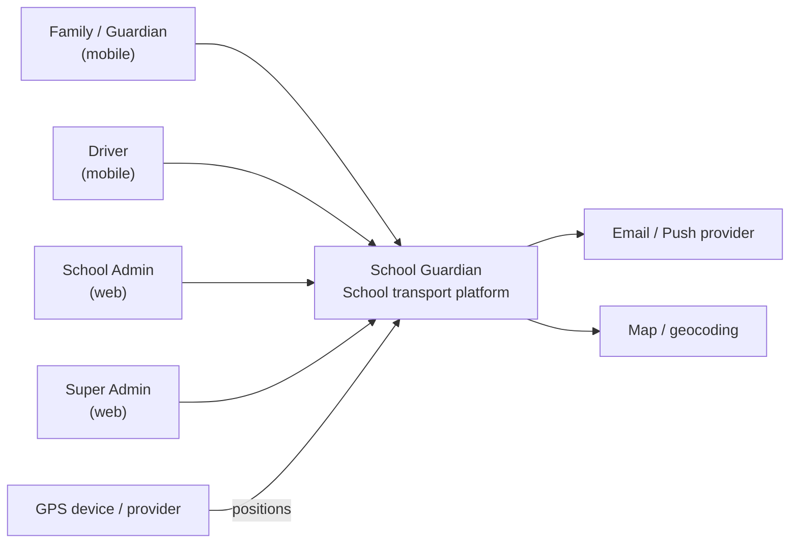
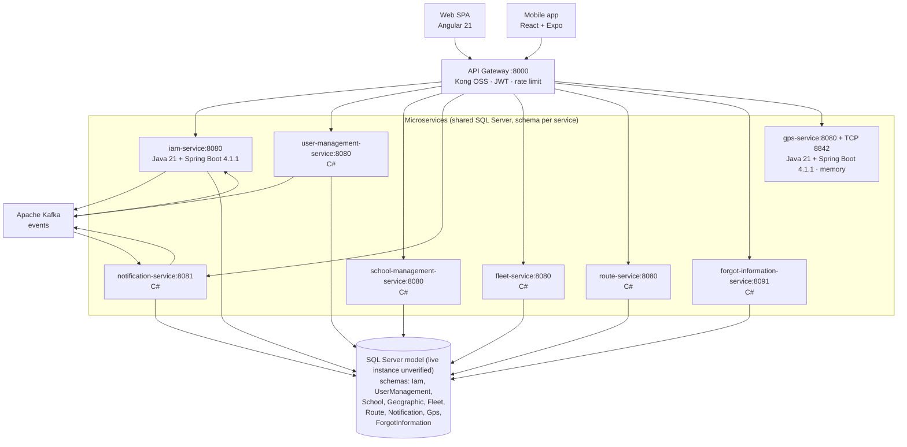

# System Architecture Overview

> Technical snapshot of School Guardian: style, C4 views, service map, principles,
> patterns, and cross-cutting concerns. Kept in sync with ADRs and the
> microservices catalog.

**Status:** Living document · **Last code/configuration alignment:** 2026-10-27
**Sources of truth:** [ADR register](./decisions/README.md) · [service catalog](../09-microservices/service-catalog.md)

> Bounded inspection of the primary local `Proyecto/sg-ms-*` repositories and
> `kafka`, not production. Eight backends (six .NET 10, two Java 21 / Spring
> Boot 4.1.1) plus Kong = nine catalog entries. Manifest versions, configured
> ports and architecture diagrams do not prove active deployments. Divergent
> copies under `schoo-guardian/backend` are not merged into this evidence.

---

## 1. Adopted architectural style

**Style:** **Microservices + Event-Driven** (polyglot services behind a single API Gateway).

**Justification:**
- Domain splits cleanly into bounded contexts (identity, fleet, routes, school, alerts…).
- Teams/services can ship independently despite a small initial team (3).
- Async events (person lifecycle, boarding and incidents) fit school-transport flows better
  than monolith background jobs.
- Polyglot stacks let each service use the best-fit runtime already known by the
  team (C#, Java) while sharing one SQL Server instance for cost (ADR-002).

**Configured edge:** clients → **Kong OSS :8000** → backend HTTP upstreams **:8080**
(Docker DNS); GPS devices send TCP frames directly to the GPS ingest port **8842**.
No GPS Kafka producer/consumer was verified.

**In-service communication:** synchronous **gRPC** (ADR-005) + asynchronous **Kafka** (ADR-004).

**Reference ADRs:**
- Communication: [ADR-004 Kafka](./decisions/records/ADR-004-kafka-message-broker.md), [ADR-005 gRPC](./decisions/records/ADR-005-grpc-inter-service-communication.md)
- Edge: [ADR-006 API Gateway (Kong OSS)](./decisions/records/ADR-006-api-gateway.md)
- Data: [ADR-002 Shared DB schema-per-service](./decisions/records/ADR-002-shared-database-monolithic-db.md)
- Auth: [ADR-008 JWT RS256](./decisions/records/ADR-008-jwt-rs256-authentication.md)

> Note: legacy contexts describing a "modular ASP.NET Core monolith" refer to
> the original codebase shape; the target and catalog state is 9 microservices
> (see [clarifications](../00-governance/documentation-rules.md)).

---

## 2. C4 — System context (Level 1)

**External actors:** families, drivers, administrators, super administrators, GPS providers.
**External systems:** notification channels (email/push), mapping/geocoding (optional),
identity documents (offline verification out of scope for MVP).

---

## 3. C4 — Container level (Level 2)

| Container | Responsibility | Notes |
|-----------|----------------|-------|
| Web SPA | Admin & super-admin UI | Angular 21 |
| Mobile | Guardian/driver UX | React + Expo |
| API Gateway | Single entry, JWT (JWKS from iam-service), routing, rate limit | Stateless, local (per-node) rate limiting |
| 9 services (gateway + 8 domain/infra) | Bounded contexts | Polyglot (Java + C#); details in catalog |
| Kafka | Async domain events | ADR-004 |
| SQL Server | Persistence design | One instance, schema per service (ADR-002); earlier RDS deployment label not verified here; GPS runtime state is in memory |

Full registry, ports, stacks: [`09-microservices/service-catalog.md`](../09-microservices/service-catalog.md).

---

## 4. Service catalog (summary)

| # | Service | Real repo | Stack | Schema | Host port |
|---|---------|-----------|-------|--------|-----------|
| 01 | api-gateway (Kong OSS) | `ms-api-gateway` | Kong OSS + Lua `sg-jwt` | — | **8000** |
| 02 | iam-service | `sg-ms-iam` | Java 21 + Spring Boot 4.1.1 | `Iam` | 8080 |
| 03 | user-management-service | `ms-user-management` | C# + ASP.NET | `UserManagement` | 8080 |
| 04 | school-management-service | `ms-school-management` | C# + ASP.NET | `School` (+ reads `Geographic`) | 8080 |
| 05 | notification-service | `ms-notification` | C# + ASP.NET | `Notification` | 8081 |
| 06 | fleet-service *(docs legacy: bus-service)* | `ms-fleet` | C# + ASP.NET | `Fleet` | 8080 |
| 07 | route-service | `ms-route` | C# + ASP.NET | `Route` | 8080 |
| 08 | gps-service | `sg-ms-gps` | Java 21 + Spring Boot 4.1.1 | `Gps` (model; in-memory runtime) | 8080 + TCP 8842 |
| 09 | forgot-information-service | `sg-ms-forgot-information` | C# + ASP.NET | `ForgotInformation` | 8091 |

> **Count authority:** 9 services (gateway + 8). Older ADR text mentioning "7 microservices"
> or "11 microservices" must not be used for capacity or routing math.
> Remaining `ms-*` repo labels above are legacy/runtime aliases for primary `sg-ms-*`
> folders; host ports are documented bindings, not verified listeners.
> The `Geographic` schema (`City`) is defined by `database/ms-geographic-db` and has **no
> owning backend service**.

---

## 5. Architectural principles

### P1: API-First
Contracts live in `07-api/contracts/openapi/` before implementation.
Guidelines: [`07-api/guidelines.md`](../07-api/guidelines.md).

### P2: Shared Monolithic Database — Schema per Service
One SQL Server instance with logical schemas. API/event-only access and no
cross-schema application JOINs are **target boundaries**, not current guarantees:
notification's `SchoolDirectory` joins IAM/School entities and `StudentDirectory`
reads IAM/UserManagement directly. The catalog records these source exceptions.
The checked-in model does use **cross-schema foreign keys** (20+ of them, e.g.
`Iam.Profile.PersonId` → `UserManagement.Person`), which is an accepted deviation that keeps
referential integrity inside the single database. Rules:
[`09-microservices/service-boundary-rules.md`](../09-microservices/service-boundary-rules.md).
Deviation from "database-per-service" is intentional and recorded in ADR-002.

### P3: Fail Fast, Recover Gracefully
Target principle: validate at the edge, health checks and graceful failure.
Do not treat circuit breakers, universal consumer idempotency or a particular
gateway failure code as verified merely because an ADR proposes them.
Current Kafka handlers log/catch failures; replay can repeat push attempts and
there is no verified transactional outbox/DLQ (catalog evidence).

### P4: Observability by Design
`X-Correlation-Id` end-to-end, structured logs, metrics + traces
(`13-operations/observability.md`), RED/USE dashboards per service.

### P5: Security by Default
JWT RS256/JWKS is implemented at IAM/Kong and independently validated in five
.NET business services with global controller authorization and endpoint
permission/role/profile filters. Recovery has no local JWT barrier; Kong
protects its email/phone changes but allows anonymous password recovery.
Least-privilege DB logins, effective tenant isolation and audit completeness
remain design goals requiring separate operational evidence.

---

## 6. Adopted architectural patterns

| Pattern | Where used | ADR / guide |
|---------|------------|-------------|
| API Gateway (edge) | All client traffic | ADR-006 |
| CQRS-lite (read models) | Dashboards aggregating events | pattern-guide |
| Event-driven choreography (Kafka) | Boarding, alerts | ADR-004 |
| Sync RPC (gRPC) | Service-to-service queries/commands | ADR-005 |
| Saga / compensations (proposal, not verified) | Multi-service assignments | service `events.md` |
| Hexagonal (ports & adapters) | Java services (iam, gps) | [hexagonal-architecture.md](./hexagonal-architecture.md) |
| Duplicate handling (partial, not universal idempotency) | Profile creation rejects existing person; scan recipients deduplicated but push can repeat | catalog source trace |
| Strangler Fig | Future monolith→service migrations | ADR-002 evolution path |

Deeper catalogue: [pattern-guide.md](./pattern-guide.md).

---

## 7. Cross-cutting concerns

| Concern | Approach |
|---------|----------|
| Authentication | IAM RS256 + JWKS; Kong and five .NET business services validate access tokens independently |
| Authorization | Global REST controller authorization plus permission/role/profile filters; recovery OTP exception; gRPC controls must be checked separately |
| Config | Env vars per compose; centralized later for *business* settings |
| Logging | JSON structured + correlation id |
| Tracing | OpenTelemetry-compatible spans across HTTP/gRPC/Kafka |
| Migrations | Liquibase per service (ADR-009) |
| API docs | **Scalar** UI over OpenAPI (ADR-007) — replaces Swagger UI |
| Rate limiting | Gateway (local/in-memory, per node) |
| Secrets | Environment / secret manager — never committed |
| i18n | UI Spanish-first; EN/FR/PT planned (product i18n) |

---

## 8. Registered architectural technical debt

| Debt | Impact | Mitigation / next step |
|------|--------|------------------------|
| Host port 8080 shared by design (Docker DNS by service name) | Confusing when running outside compose | Document: always call services by container name on the Docker network; host mapping is per-service override only if needed |
| Legacy "modular monolith" wording in UX/context docs | Confusion about deployables | Rewrite references to microservices catalog |
| Legacy contract filenames vs canonical `iam-service` naming | Broken contract links | Canonical name `iam-service`; keep legacy aliases only as redirects until renamed |
| Single shared SQL Server | No physical isolation | Schema guards + login-per-schema; revisit on scale |
| OpenAPI coverage/implementation correspondence not exhaustive | Contract drift | Validate eight backend contracts against code; templates are not services |
| ADR-003 still **Proposed** | Decision ambiguity on monolithic web/mobile client | Team acceptance pass → Accepted |

---

## 9. Planned evolution

1. **Complete and validate contracts** for the eight backends + Scalar portal (ADR-007);
   retain older service-count proposals only as historical context.
2. **Observability baseline:** metrics, traces, SLOs (`13-operations/`).
3. **Scale-out path:** if one schema dominates load → extract to own instance
   (Strangler Fig, ADR-002).
4. **Optional:** BFF for web/mobile aggregates if chatty composition appears.
5. **Multi-tenant readiness:** school_id isolation review before first external
   customer beyond pilot (Neiva, Huila).

---

## Key correlations

The [catalog's source trace and integration limits](../09-microservices/service-catalog.md#verified-authentication-and-integration-limits-2026-10-27)
record the JWT/JWKS emitter, per-.NET checks, Kong public-prefix/GPS/CORS behavior,
Kafka topics/payloads/groups and gRPC contracts. Alerts saved before publication,
events processed, push sends attempted and device delivery receipts are distinct
outcomes; only the first three have code paths here, with no end-to-end guarantee.
Live deployments, TLS/network boundaries, broker replay and provider/device
delivery remain unverified. Historical ADR proposals are not treated as implemented
patterns or proof of production activity.

| Artifact | Path |
|----------|------|
| ADRs | `05-architecture/decisions/records/` |
| Patterns | `05-architecture/pattern-guide.md` |
| Hexagonal guide | `05-architecture/hexagonal-architecture.md` |
| Service catalog | `09-microservices/service-catalog.md` |
| Boundary rules | `09-microservices/service-boundary-rules.md` |
| Data ownership | `09-microservices/data-ownership-matrix.md` |
| OpenAPI | `07-api/contracts/openapi/` |
| C4 sources | `08-uml/diagrams/source/` |
| Domain map | `02-domain/domain-map.md` |