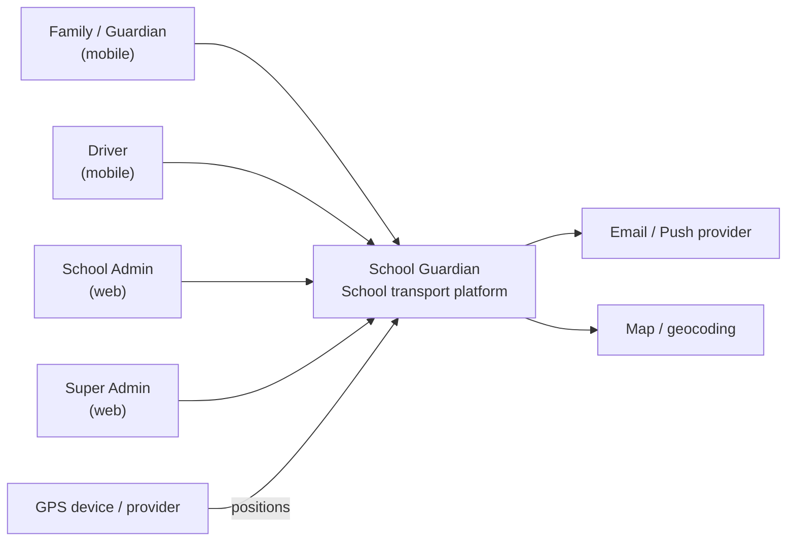
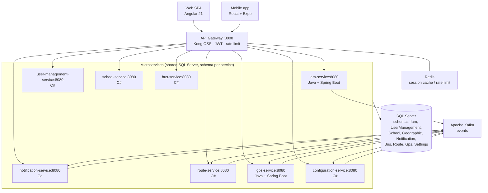

# System Architecture Overview

> Technical snapshot of School Guardian: style, C4 views, service map, principles,
> patterns, and cross-cutting concerns. Kept in sync with ADRs and the
> microservices catalog.

**Status:** Living document · **Last aligned:** 2026-09-22
**Sources of truth:** [ADR register](./decisions/README.md) · [service catalog](../09-microservices/service-catalog.md)

---

## 1. Adopted architectural style

**Style:** **Microservices + Event-Driven** (polyglot services behind a single API Gateway).

**Justification:**
- Domain splits cleanly into bounded contexts (identity, fleet, routes, school, alerts…).
- Teams/services can ship independently despite a small initial team (3).
- Async events (boarding, GPS, alerts) fit real-time school-transport flows better
  than monolith background jobs.
- Polyglot stacks let each service use the best-fit runtime already known by the
  team (C#, Java, Go) while sharing one SQL Server instance for cost (ADR-002).

**Edge:** clients → **Kong OSS :8000** → business services **:8080** (Docker DNS by service name).

**In-service communication:** synchronous **gRPC** (ADR-005) + asynchronous **Kafka** (ADR-004).

**Reference ADRs:**
- Communication: [ADR-004 Kafka](./decisions/records/ADR-004-kafka-message-broker.md), [ADR-005 gRPC](./decisions/records/ADR-005-grpc-inter-service-communication.md)
- Edge: [ADR-006 API Gateway (Kong OSS)](./decisions/records/ADR-006-api-gateway.md)
- Data: [ADR-002 Shared DB schema-per-service](./decisions/records/ADR-002-shared-database-monolithic-db.md)
- Auth: [ADR-008 JWT RS256](./decisions/records/ADR-008-jwt-rs256-authentication.md)

> Note: legacy contexts describing a "modular ASP.NET Core monolith" refer to
> the original codebase shape; the target and catalog state is 11 microservices
> (see [clarifications](../00-governance/documentation-rules.md)).

---

## 2. C4 — System context (Level 1)

**External actors:** families, drivers, administrators, super administrators, GPS providers.
**External systems:** notification channels (email/push), mapping/geocoding (optional),
identity documents (offline verification out of scope for MVP).

---

## 3. C4 — Container level (Level 2)

| Container | Responsibility | Notes |
|-----------|----------------|-------|
| Web SPA | Admin & super-admin UI | Angular 21 |
| Mobile | Guardian/driver UX | React + Expo |
| API Gateway | Single entry, JWT, routing, rate limit | Stateless + Redis |
| 9 services (gateway + 8 domain/infra) | Bounded contexts | Polyglot; details in catalog |
| Kafka | Async domain events | ADR-004 |
| SQL Server | Persistence | One instance, schema per service (ADR-002) |
| Redis | Ephemeral state | Tokens cache, rate limits |

Full registry, ports, stacks: [`09-microservices/service-catalog.md`](../09-microservices/service-catalog.md).

---

## 4. Service catalog (summary)

| # | Service | Stack | Schema | Port |
|---|---------|-------|--------|------|
| 01 | api-gateway (Kong OSS) | Kong OSS | — (Redis only) | **8000** |
| 02 | iam-service | Java + Spring Boot | `Iam` | 8080 |
| 03 | user-management-service | C# + ASP.NET | `UserManagement` | 8080 |
| 04 | school-service | C# + ASP.NET | `School` + `Geographic` | 8080 |
| 05 | notification-service | Go | `Notification` | 8080 |
| 06 | bus-service | C# + ASP.NET | `Bus` | 8080 |
| 07 | route-service | C# + ASP.NET | `Route` | 8080 |
| 08 | gps-service | Java + Spring Boot | `Gps` | 8080 |
| 11 | configuration-service | C# + ASP.NET | `Settings` | 8080 |

> **Count authority:** 9 services (gateway + 8). Older ADR text mentioning "7 microservices"
> predates the split and must not be used for capacity or routing math.

---

## 5. Architectural principles

### P1: API-First
Contracts live in `07-api/contracts/openapi/` before implementation.
Guidelines: [`07-api/guidelines.md`](../07-api/guidelines.md).

### P2: Shared Monolithic Database — Schema per Service
One SQL Server instance, logical isolation per service, no cross-schema JOINs
or FKs. Rules: [`09-microservices/service-boundary-rules.md`](../09-microservices/service-boundary-rules.md).
Deviation from "database-per-service" is intentional and recorded in ADR-002.

### P3: Fail Fast, Recover Gracefully
Validate at the edge; health endpoints; circuit breakers on gRPC; consumers
idempotent; gateway returns 503 when critical upstreams are down.

### P4: Observability by Design
`X-Correlation-Id` end-to-end, structured logs, metrics + traces
(`13-operations/observability.md`), RED/USE dashboards per service.

### P5: Security by Default
JWT RS256 at the gateway (ADR-008), RBAC deny-by-default, least-privilege DB
logins per schema, secrets out of Git, audit trail for sensitive actions.

---

## 6. Adopted architectural patterns

| Pattern | Where used | ADR / guide |
|---------|------------|-------------|
| API Gateway (edge) | All client traffic | ADR-006 |
| CQRS-lite (read models) | Dashboards aggregating events | pattern-guide |
| Event-driven choreography (Kafka) | Boarding, alerts | ADR-004 |
| Sync RPC (gRPC) | Service-to-service queries/commands | ADR-005 |
| Saga / compensations | Multi-service assignments | service `events.md` |
| Hexagonal (ports & adapters) | Java services (iam, gps) | [hexagonal-architecture.md](./hexagonal-architecture.md) |
| Idempotent consumers | Kafka handlers | boundary rules |
| Strangler Fig | Future monolith→service migrations | ADR-002 evolution path |

Deeper catalogue: [pattern-guide.md](./pattern-guide.md).

---

## 7. Cross-cutting concerns

| Concern | Approach |
|---------|----------|
| Authentication | JWT RS256 via gateway (ADR-008) — [auth doc](../07-api/authentication.md) |
| Authorization | RBAC in `iam-service`; permissions in token |
| Config | Env vars per compose; centralized later (config service for *business* settings) |
| Logging | JSON structured + correlation id |
| Tracing | OpenTelemetry-compatible spans across HTTP/gRPC/Kafka |
| Migrations | Liquibase per service (ADR-009) |
| API docs | **Scalar** UI over OpenAPI (ADR-007) — replaces Swagger UI |
| Rate limiting | Gateway (Redis counters) |
| Secrets | Environment / secret manager — never committed |
| i18n | UI Spanish-first; EN/FR/PT planned (product i18n) |

---

## 8. Registered architectural technical debt

| Debt | Impact | Mitigation / next step |
|------|--------|------------------------|
| Host port 8080 shared by design (Docker DNS by service name) | Confusing when running outside compose | Document: always call services by container name on the Docker network; host mapping is per-service override only if needed |
| Legacy "modular monolith" wording in UX/context docs | Confusion about deployables | Rewrite references to microservices catalog |
| Legacy contract filenames vs canonical `iam-service` naming | Broken contract links | Canonical name `iam-service`; keep legacy aliases only as redirects until renamed |
| Single shared SQL Server | No physical isolation | Schema guards + login-per-schema; revisit on scale |
| OpenAPI coverage incomplete for services 03–11 | Contract drift | Generate from template per service (see `07-api/README.md`) |
| ADR-003 still **Proposed** | Decision ambiguity on monolithic web/mobile client | Team acceptance pass → Accepted |

---

## 9. Planned evolution

1. **Complete contracts** for all 11 services + Scalar portal (ADR-007).
2. **Observability baseline:** metrics, traces, SLOs (`13-operations/`).
3. **Scale-out path:** if one schema dominates load → extract to own instance
   (Strangler Fig, ADR-002).
4. **Optional:** BFF for web/mobile aggregates if chatty composition appears.
5. **Multi-tenant readiness:** school_id isolation review before first external
   customer beyond pilot (Neiva, Huila).

---

## Key correlations

| Artifact | Path |
|----------|------|
| ADRs | `05-architecture/decisions/records/` |
| Patterns | `05-architecture/pattern-guide.md` |
| Hexagonal guide | `05-architecture/hexagonal-architecture.md` |
| Service catalog | `09-microservices/service-catalog.md` |
| Boundary rules | `09-microservices/service-boundary-rules.md` |
| Data ownership | `09-microservices/data-ownership-matrix.md` |
| OpenAPI | `07-api/contracts/openapi/` |
| C4 sources | `08-uml/diagrams/source/` |
| Domain map | `02-domain/domain-map.md` |