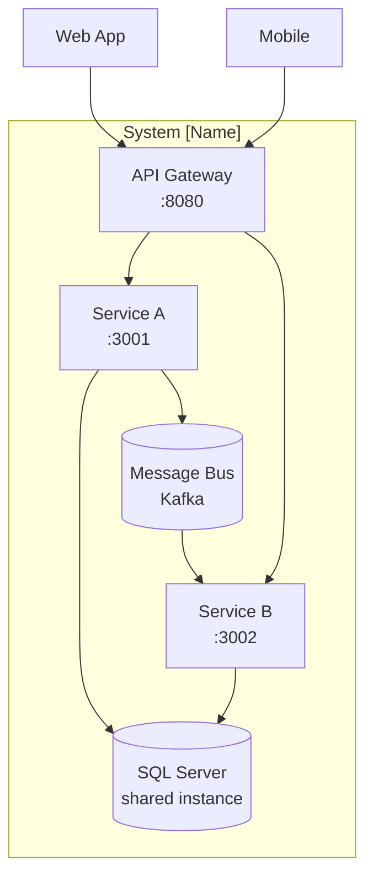

# System Architecture Overview

> **What to fill in here:** The architectural view is the technical snapshot of the system.
> It includes the C4 system and container diagram, service list, and architectural principles.
> This document is created after the main ADRs and guides the implementation.

---

## 1. Adopted architectural style

**Style:** [Microservices / Microservices + Event-Driven / Modular Monolith / etc.]

**Justification:** [Why this style for this project and these requirements]

**Reference ADR:** [`ADR-001-architectural-style.md`](decisions/records/)

---

## 2. C4 Diagram — System Level (Context)

> Shows how the system fits in the world. External actors and external systems.

```
┌─────────────────────────────────────────────────────────────────────┐
│                        System [Name]                                │
│                                                                     │
│  ┌─────────────┐    ┌─────────────┐    ┌────────────────────────┐  │
│  │ [Service A] │    │ [Service B] │    │ [Service C]            │  │
│  │             │    │             │    │                        │  │
│  │ Port: 3001  │    │ Port: 3002  │    │ Port: 3003             │  │
│  └──────┬──────┘    └──────┬──────┘    └──────────┬─────────────┘  │
│         │                  │                       │                │
│         └──────────────────┴───────────────────────┘                │
│                            │ Message Bus                             │
└────────────────────────────│────────────────────────────────────────┘
                             │
                  ┌──────────┴──────────┐
                  │                     │
         ┌────────▼──────┐    ┌─────────▼──────┐
         │ API Gateway   │    │ Admin Dashboard │
         │               │    │                 │
         └────────┬──────┘    └─────────────────┘
                  │
         ┌────────▼──────────────┐
         │    External clients   │
         │  (Web, Mobile, API)   │
         └───────────────────────┘
```

---

## 3. C4 Diagram — Container Level

> Shows the processes, databases, and main communication channels.

```
Replace this block with the project-specific diagram.

Recommended tools:
- PlantUML (see 08-uml/diagrams/source/)
- Mermaid (natively supported on GitHub)
- draw.io / Lucidchart
```

**Mermaid example:**



---

## 4. Service catalog

| # | Service | Responsibility | Port | DB | Communication type |
|---|---------|---------------|------|-----|-------------------|
| 1 | api-gateway | Routing, auth, rate limiting | 8080 | Redis (cache) | HTTP Proxy |
| 2 | iam-service | Registration, login, JWT tokens | 3001 | SQL Server (schema `identity`) | REST + Events |
| 3 | [xxx-service] | [responsibility] | 300X | SQL Server (schema `[xxx]`) | [REST/Async] |

> All services share a single SQL Server instance, each with its own schema (see ADR-002).
> Full detail per service in `09-microservices/service-catalog.md`

---

## 5. Architectural principles

These principles guide the project's technical decisions. Before making an important decision,
verify it is consistent with these principles.

### P1: API-First
Design the API contract (OpenAPI) before implementing the service.
Contracts are the source of truth for consumers.

### P2: Shared Monolithic Database — Schema per Service
A single SQL Server instance is shared by all microservices, but each service only owns
and accesses its **own schema** (logical isolation). No service reads or writes another
service's schema, and inter-service communication is always through API or events
(never JOINs across schemas).

> Deviation from the framework default "Database per Service", justified in
> ADR-002. If the data volume or team grows, migrate gradually to separate
> databases (Strangler Fig).

### P3: Fail Fast, Recover Gracefully
Detect errors early (validation at the edge). When an external service fails,
use Circuit Breaker to prevent cascades. Always define a fallback.

### P4: Observability by Design
From day 1: structured JSON logs, metrics with Prometheus,
distributed traces with Jaeger/Zipkin. It is not optional or a story for "later".

### P5: [Additional principle name]
[Description]

---

## 6. Adopted architectural patterns

| Pattern | Adopted | Reference |
|---------|---------|-----------|
| API Gateway | Yes | `05-architecture/pattern-guide.md` |
| Database per Service | No | ADR-002 (deviation: shared DB, schema per service) |
| CQRS | No (review in Q3) | |
| Event Sourcing | No | |
| Circuit Breaker | Yes | ADR-00X |
| Saga (choreographed) | Yes | ADR-00X |
| Outbox Pattern | Yes | ADR-00X |

---

## 7. Cross-cutting concerns

Transversal concerns that apply to ALL services:

| Concern | Adopted solution | Where it is configured |
|---------|----------------|------------------------|
| Authentication / Authorization | JWT + validation in API Gateway | `00-governance/security-policy.md` |
| Logging | Structured JSON + Correlation ID | Shared logger in internal lib |
| Tracing | OpenTelemetry → Jaeger | Middleware in each service |
| Health Checks | GET /health (liveness) + GET /health/ready (readiness) | Service template |
| Error format | Standard ErrorResponse | `07-api/contracts/openapi/_shared.yaml` |
| Rate Limiting | At the API Gateway | Kong/NGINX configuration |
| CORS | Configured in API Gateway | |
| Circuit Breaker | Resiliency4j / opossum per service | Pattern in `pattern-guide.md` |

---

## 8. Registered architectural technical debt

| ID | Description | Impact | Priority | Target sprint |
|----|-------------|--------|---------|--------------|
| AT-001 | [description] | [high/medium/low] | [P1/P2/P3] | [Sprint X] |

> See also: `15-project-control/technical-backlog.md`

---

## 9. Planned evolution

| Version | Architectural change | Motivation | Estimated date |
|---------|---------------------|------------|----------------|
| v2.0 | [e.g.: Migrate to gRPC for internal communication] | [Latency] | [Q4 2024] |

---

## Key correlations

- Domain bounded contexts → `02-domain/domain-map.md`
- Specific decision ADRs → `05-architecture/decisions/`
- Hexagonal architecture per service → `05-architecture/hexagonal-architecture.md`
- Applied patterns → `05-architecture/pattern-guide.md`
- Per-service detail → `09-microservices/service-catalog.md`
- UML diagrams → `08-uml/`
