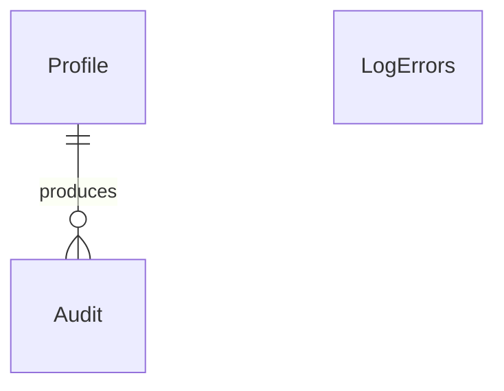

# Data Models per Service

## Service: Audit

**DB Engine:** SQL Server 15.

**Engine justification:**
- SQL Server provides durable transactions for append-only action and error records.
- Schema isolation and indexed timestamps support audit retrieval without cross-service joins.

### Table: Audit

**Purpose:** Records actions performed by profiles.

```sql
CREATE TABLE Audit (
	Id INT PRIMARY KEY IDENTITY, 
    ProfileId UUID NOT NULL, 
    Action VARCHAR(255) NOT NULL,
	DateTime DATETIME2 NOT NULL, 
    Description VARCHAR(500) NOT NULL,
	IPAddress VARCHAR(50) NOT NULL, 
    Application VARCHAR(255) NOT NULL
);
```

**Data dictionary:**

| Column | Type | Description | Example |
|--------|------|-------------|---------|
| Id | INT | Audit record identifier | `1001` |
| ProfileId | UUID | Acting profile reference | `550e8400-...` |
| Action | VARCHAR(255) | Action performed | `Route.Read` |
| DateTime | DATETIME2 | Action timestamp | `2026-09-08T08:00:00Z` |
| Description | VARCHAR(500) | Action detail | `Viewed route` |
| IPAddress | VARCHAR(50) | Client address | `192.0.2.10` |
| Application | VARCHAR(255) | Originating application | `MobileApp` |

**Modeling decisions:**
1. `ProfileId` is an API/event reference to IAM, not a cross-schema join.
2. `Application` preserves the client origin for multi-channel investigations.

### Table: LogErrors

**Purpose:** Stores system error records.

```sql
CREATE TABLE LogErrors (
	Id INT PRIMARY KEY IDENTITY, 
    TypeError VARCHAR(100) NOT NULL,
	Description VARCHAR(255) NOT NULL, 
    IPAddress VARCHAR(50) NOT NULL
);
```

**Data dictionary:**

| Column | Type | Description | Example |
|--------|------|-------------|---------|
| Id | INT | Error record identifier | `2001` |
| TypeError | VARCHAR(100) | Error classification | `Timeout` |
| Description | VARCHAR(255) | Error detail | `GPS provider unavailable` |
| IPAddress | VARCHAR(50) | Related client address | `192.0.2.10` |

**Modeling decisions:**
1. Error records remain separate from user actions for operational filtering.
2. Both tables are append-only to preserve evidence.

### Indexes

| Name | Fields | Type | Justification |
|------|--------|------|---------------|
| IX_Audit_ProfileId | ProfileID | Nonclustered | Profile history lookup |
| IX_Audit_Date | Date | Nonclustered | Chronological audit lookup |
| IX_Audit_Application | Application | Nonclustered | Application-origin lookup |
| IX_LogErrors_TypeError | TypeError | Nonclustered | Error classification filtering |

## Migration strategy

**Tool:** Versioned SQL Server migrations.

**File naming convention:** `V{Version}__{Description}.sql`

**Migration rules:**
1. Migrations are forward-only and contain one logical change.
2. Append-only records are never rewritten or physically deleted.
3. Existing migrations are immutable after execution.

```
Migrations are forward-only and immutable after execution.
Audit and error records are append-only evidence.
Retention or archival is handled by an explicit operational migration.
```

**Compatible schema changes (non-breaking):**

```sql
ALTER TABLE Audit ADD CorrelationId UUID NULL;
CREATE INDEX IX_Audit_Application ON Audit (Application);
CREATE INDEX IX_Audit_ProfileID ON Audit (ProfileId);
CREATE INDEX IX_Audit_DateTime ON Audit (DateTime);
CREATE INDEX IX_LogErrors_TypeError ON LogErrors (TypeError);
```

**Incompatible changes (require 2-phase migration):**

```sql
ALTER TABLE Audit ADD OccurredAt DATETIME2 NULL;
UPDATE Audit SET OccurredAt = Date;
ALTER TABLE Audit DROP COLUMN Date;
```

## DB engine selection guide

| Engine | Use when... | Avoid when... |
|--------|------------|---------------|
| **SQL Server** | Durable append-only audit evidence and indexed investigations | Ephemeral counters or cache-only state |
| **PostgreSQL** | ACID transactions, complex relationships, JSONB, full-text search | Deeply nested documents |
| **MongoDB** | Flexible log documents and catalogs | Complex transactions across collections |
| **Redis** | Cache, sessions, TTL state, and counters | Durable audit evidence |
| **Elasticsearch** | Full-text search, analytics, and log exploration | Authoritative audit storage |

## Relationship diagram (per service)



## Correlations

- Authoritative source: `09-microservices/services/10-audit-service/data-model.md`
- `ProfileID` correlation: `06-data/domain/iam.md`
- Audit events and operational logging: `13-operations/observability.md`
