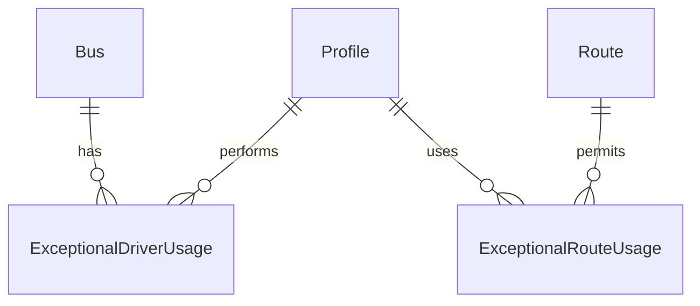

# Data Models per Service

## Service: Exceptional

**DB Engine:** SQL Server 15.

**Engine justification:**
- SQL Server provides transactional records for exceptional driver and route usage.
- Indexed UUID references support operational lookups while preserving service ownership boundaries.

### Table: ExceptionalDriverUsage

**Purpose:** Records a driver operating a bus outside the normal assignment.

```sql
CREATE TABLE ExceptionalDriverUsage (
	ID UUID PRIMARY KEY, 
    BusID UUID NOT NULL, 
    ProfileID UUID NOT NULL,
	DateTime DATETIME2 NOT NULL, 
    Reason VARCHAR(200) NOT NULL,
	Status VARCHAR(20) NOT NULL CHECK (Status IN ('Active', 'Inactive')) DEFAULT 'Active'
);
```

**Data dictionary:**

| Column | Type | Description | Example |
|--------|------|-------------|---------|
| Id | UUID | Usage record identifier | `550e8400-...` |
| BusId | UUID | Bus reference | `550e8400-...` |
| ProfileId | UUID | Driver profile reference | `550e8400-...` |
| DateTime | DATETIME2 | Exceptional usage timestamp | `2026-09-08T08:00:00Z` |
| Reason | VARCHAR(200) | Business justification | `Replacement driver` |
| Status | VARCHAR(20) | Lifecycle status | `Active` |

**Modeling decisions:**
1. Bus and profile IDs are external correlations resolved through service contracts.
2. Status preserves exceptional-use history without hard deletion.

### Table: ExceptionalRouteUsage

**Purpose:** Records a student using a route outside the normal assignment.

```sql
CREATE TABLE ExceptionalRouteUsage (
	Id UUID PRIMARY KEY, 
    ProfileId UUID NOT NULL, 
    RouteId UUID NOT NULL,
	StartDateTime DATETIME NOT NULL, 
    EndDateTime DATETIME NOT NULL,
	Reason VARCHAR(200) NOT NULL, 
	Status VARCHAR(20) NOT NULL CHECK (Status IN ('Active', 'Inactive')) DEFAULT 'Active'
);
```

**Data dictionary:**

| Column | Type | Description | Example |
|--------|------|-------------|---------|
| Id | UUID | Usage record identifier | `550e8400-...` |
| ProfileId | UUID | Student profile reference | `550e8400-...` |
| RouteId | UUID | Route reference | `550e8400-...` |
| StartDateTime | DATETIME | Usage start | `2026-09-08T08:00:00Z` |
| EndDateTime | DATETIME | Usage end | `2026-09-08T16:00:00Z` |
| Reason | VARCHAR(200) | Business justification | `Temporary relocation` |
| Status | VARCHAR(20) | Lifecycle status | `Active` |

**Modeling decisions:**
1. Separate start and end timestamps support duration and overlap validation.
2. The table remains separate because route exceptions have different references from driver exceptions.

### Indexes

| Name | Fields | Type | Justification |
|------|--------|------|---------------|
| IX_ExceptionalDriverUsage_BusId | BusId | Nonclustered | Bus exception lookup |
| IX_ExceptionalDriverUsage_ProfileId | ProfileId | Nonclustered | Driver exception lookup |
| IX_ExceptionalRouteUsage_RouteId | RouteId | Nonclustered | Route exception lookup |
| IX_ExceptionalRouteUsage_StartDateTime | StartDateTime | Nonclustered | Exception period lookup |

## Migration strategy

**Tool:** Versioned SQL Server migrations.

**File naming convention:** `V{Version}__{Description}.sql`

**Migration rules:**
1. Apply one forward-only logical change per migration.
2. Add new exception attributes as nullable before making them required.
3. Retain records and use `Status` for lifecycle changes.

```
Migrations are forward-only and immutable after execution.
Exception records are retained for operational review.
External bus, profile, and route identifiers remain service correlations.
```

**Compatible schema changes (non-breaking):**

```sql
ALTER TABLE ExceptionalRouteUsage ADD Notes VARCHAR(200) NULL;
CREATE INDEX IX_ExceptionalRouteUsage_StartDateTime ON ExceptionalRouteUsage (StartDateTime);
CREATE INDEX IX_ExceptionalDriverUsage_BusId ON ExceptionalDriverUsage (BusId);
CREATE INDEX IX_ExceptionalDriverUsage_ProfileId ON ExceptionalDriverUsage (ProfileId);
CREATE INDEX IX_ExceptionalRouteUsage_RouteId ON ExceptionalRouteUsage (RouteId);
```

**Incompatible changes (require 2-phase migration):**

```sql
ALTER TABLE ExceptionalDriverUsage ADD OccurredAt DATETIME NULL;
UPDATE ExceptionalDriverUsage SET OccurredAt = DateTime;
ALTER TABLE ExceptionalDriverUsage DROP COLUMN DateTime;
```

## DB engine selection guide

| Engine | Use when... | Avoid when... |
|--------|------------|---------------|
| **SQL Server** | ACID exception records and indexed operational references | Ephemeral counters or unstructured documents |
| **PostgreSQL** | ACID transactions, complex relationships, JSONB, full-text search | Deeply nested documents |
| **MongoDB** | Flexible exception documents | Complex transactions across collections |
| **Redis** | Cache, sessions, TTL state, and counters | Authoritative exception history |
| **Elasticsearch** | Search, analytics, and operational logs | Source of truth for exceptions |

## Relationship diagram (per service)



## Correlations

- Authoritative source: `09-microservices/services/09-exceptional-service/data-model.md`
- Bus correlation: `06-data/domain/bus.md`
- Profile correlation: `06-data/domain/iam.md`
- Route correlation: `06-data/domain/route.md`
