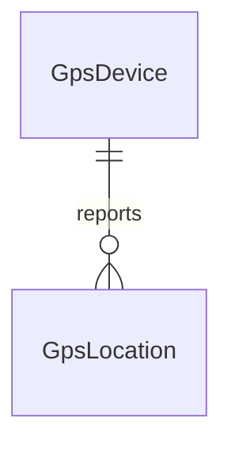

# Data Models per Service

## Service: Gps

**DB Engine:** SQL Server 16.

**Engine justification:**
- SQL Server provides durable relational storage for device registration and position history.
- Compound operational indexes support latest-position and device availability queries.

### Table: GpsDevice

**Purpose:** Registers physical GPS devices mounted on buses.

```sql
CREATE TABLE GpsDevice (
    Id UNIQUEIDENTIFIER PRIMARY KEY,
    Imei VARCHAR(20) UNIQUE NOT NULL,
    LastConnection DATETIME2 NOT NULL,
    GpsStatus BOOLEAN NOT NULL
);
```

**Data dictionary:**

| Column | Type | Description | Example |
|--------|------|-------------|---------|
| Id | UNIQUEIDENTIFIER | Device identifier | `550e8400-...` |
| Imei | VARCHAR(20) | Device IMEI | `359881234567890` |
| LastConnection | DATETIME2 | Last device connection | `2026-09-08T12:00:00Z` |
| GpsStatus | BOOLEAN | GPS status | TRUE |

**Modeling decisions:**
1. IMEI is unique when supplied, while registration can precede device activation.
2. `LastConnection` supports availability checks without replacing location history.

### Table: GpsLocation

**Purpose:** Stores positions reported by GPS devices.

```sql
CREATE TABLE GpsLocation (
	Id UNIQUEIDENTIFIER PRIMARY KEY,
    GpsDeviceId UNIQUEIDENTIFIER NOT NULL,
    Latitude DECIMAL(10,7) NOT NULL,
	Longitude DECIMAL(10,7) NOT NULL, 
    Speed DECIMAL(8,2) NOT NULL, 
    Course DECIMAL(8,2) NOT NULL,
	DateTime DATETIME2 NOT NULL
);
```

**Data dictionary:**

| Column | Type | Description | Example |
|--------|------|-------------|---------|
| ID | UNIQUEIDENTIFIER | Location identifier | `550e8400-...` |
| GpsDeviceID | UNIQUEIDENTIFIER | Reporting device | `550e8400-...` |
| Latitude | DECIMAL(10,7) | Latitude coordinate | `4.7110000` |
| Longitude | DECIMAL(10,7) | Longitude coordinate | `-74.0721000` |
| Speed | DECIMAL(8,2) | Vehicle speed | `35.50` |
| Course | DECIMAL(8,2) | Heading in degrees | `90.00` |
| DateTime | DATETIME2 | Position timestamp | `2026-09-08T12:01:00Z` |

**Modeling decisions:**
1. Seven decimal places preserve GPS-grade coordinate precision.
2. Location history is separate from the device’s current connection state.

### Indexes

| Name | Fields | Type | Justification |
|------|--------|------|---------------|
| UX_GpsDevice_Imei | Imei | Unique | Identifies each physical device |
| IX_GpsLocation_GpsDeviceID | GpsDeviceID | Nonclustered | Device history lookup |
| IX_GpsLocation_DateTime | DateTime | Nonclustered | Chronological position lookup |

## Migration strategy

**Tool:** Versioned SQL Server migrations.

**File naming convention:** `V{Version}__{Description}.sql`

**Migration rules:**
1. Apply schema changes forward-only and keep executed migrations immutable.
2. Partition or archive location history through a planned operational migration.
3. Add indexes online where supported to protect ingestion availability.

```
Migrations are forward-only and immutable after execution.
Location history is retained or archived through an explicit operational plan.
Ingestion indexes are added without blocking device writes where supported.
```

**Compatible schema changes (non-breaking):**

```sql
ALTER TABLE GpsLocation ADD Accuracy DECIMAL(8,2) NULL;
CREATE INDEX IX_GpsLocation_GpsDeviceID_DateTime ON GpsLocation (GpsDeviceID, DateTime);
CREATE UNIQUE INDEX UX_GpsDevice_Imei ON GpsDevice (Imei);
CREATE INDEX IX_GpsLocation_GpsDeviceID ON GpsLocation (GpsDeviceID);
CREATE INDEX IX_GpsLocation_DateTime ON GpsLocation (DateTime);
```

**Incompatible changes (require 2-phase migration):**

```sql
ALTER TABLE GpsLocation ADD RecordedAt DATETIME NULL;
UPDATE GpsLocation SET RecordedAt = DateTime;
ALTER TABLE GpsLocation DROP COLUMN DateTime;
```

## DB engine selection guide

| Engine | Use when... | Avoid when... |
|--------|------------|---------------|
| **SQL Server** | Durable device registry and relational position history | Extremely high-volume time series without partitioning |
| **MongoDB** | Flexible telemetry documents and catalogs | Complex transactions across collections |
| **Redis** | Latest-position cache, TTL state, and counters | Durable location history |
| **Elasticsearch** | Search and analytics over operational telemetry | Authoritative device state |

## Relationship diagram (per service)



## Correlations

- Authoritative source: `09-microservices/services/08-gps-service/data-model.md`
- Bus device correlation: `06-data/domain/bus.md`
- Location use in route tracking: `06-data/domain/route.md`
