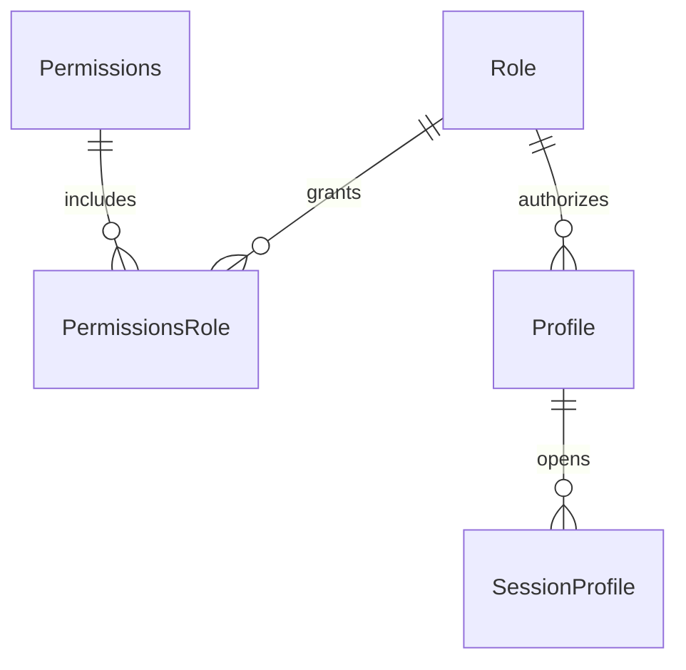

# Data Models per Service

## Service: Iam

**DB Engine:** SQL Server 16.

**Engine justification:**
- SQL Server provides transactional consistency for identity, RBAC, profiles, and sessions.
- The `Iam` schema is isolated within the shared SQL Server instance defined by ADR-002.

### Table: Role

**Purpose:** Defines the roles available for profile authorization.

```sql
CREATE TABLE Role (
    Id          TINYINT      PRIMARY KEY IDENTITY,
    Name        VARCHAR(20)  UNIQUE NOT NULL,
    Description VARCHAR(100) NOT NULL,
    Status      VARCHAR(20)  NOT NULL CHECK (Status IN ('Active', 'Inactive')) DEFAULT 'Active'
);
```

**Data dictionary:**

| Column | Type | Description | Example |
|--------|------|-------------|---------|
| Id | TINYINT | Unique role identifier | `1` |
| Name | VARCHAR(20) | Role name | `ADMIN` |
| Description | VARCHAR(100) | Role description | `School administrator` |
| Status | VARCHAR(20) | Lifecycle status | `Active` |

**Modeling decisions:**
1. `TINYINT` is sufficient for the small, controlled role catalog.
2. `Status` supports logical deactivation without deleting authorization history.

---

### Table: Permissions

**Purpose:** Defines the permissions that can be assigned to roles.

```sql
CREATE TABLE Permissions (
    Id              TINYINT       PRIMARY KEY IDENTITY,
    TypePermissions VARCHAR(100)  NOT NULL,
    Description     VARCHAR(150)  NOT NULL
);
```

**Data dictionary:**

| Column | Type | Description | Example |
|--------|------|-------------|---------|
| Id | TINYINT | Unique permission identifier | `1` |
| TypePermissions | VARCHAR(100) | Permission identifier | `Route.Read` |
| Description | VARCHAR(255) | Permission description | `Read routes` |

**Modeling decisions:**
1. Permission names remain data so new capabilities do not require a table change.

---

### Table: PermissionsRole

**Purpose:** Associates permissions with roles.

```sql
CREATE TABLE PermissionsRole (
    Id            TINYINT PRIMARY KEY IDENTITY,
    PermissionsId TINYINT NOT NULL REFERENCES Permissions(Id),
    RoleId        TINYINT NOT NULL REFERENCES Role(Id)
);
```

**Data dictionary:**

| Column | Type | Description | Example |
|--------|------|-------------|---------|
| Id | TINYINT | Unique association identifier | `1` |
| PermissionsId | TINYINT | Referenced permission | `1` |
| RoleId | TINYINT | Referenced role | `2` |

**Modeling decisions:**
1. The association table supports many-to-many RBAC relationships.
2. Foreign keys prevent assignments to missing roles or permissions.

---

### Table: Profile

**Purpose:** Connects a person with authentication and school context.

```sql
CREATE TABLE Profile (
    Id           UNIQUEIDENTIFIER PRIMARY KEY,
    PersonId     UNIQUEIDENTIFIER NOT NULL,
    CampuseId    UNIQUEIDENTIFIER NOT NULL,
    PasswordHash VARCHAR(100) NOT NULL,
    RoleId       TINYINT      NOT NULL REFERENCES Role(Id),
    Status       VARCHAR(20)  NOT NULL CHECK (Status IN ('Active', 'Inactive')) DEFAULT 'Active'
);
```

**Data dictionary:**

| Column | Type | Description | Example |
|--------|------|-------------|---------|
| Id | UNIQUEIDENTIFIER | Profile identifier | `550e8400-e29b-41d4-a716-446655440000` |
| PersonId | UNIQUEIDENTIFIER | Person identifier from UserManagement | `...` |
| CampuseId | UNIQUEIDENTIFIER | Campuse identifier from School | `...` |
| PasswordHash | VARCHAR(100) | Stored password hash | `hashed-value` |
| RoleId | TINYINT | Assigned role | `1` |
| Status | VARCHAR(20) | Lifecycle status | `Active` |

**Modeling decisions:**
1. `PersonId` and `CampuseId` are API or event references; there are no cross-schema joins.
2. Passwords are stored only as hashes, never as clear text.

---

### Table: SessionProfile

**Purpose:** Tracks login sessions for a profile.

```sql
CREATE TABLE SessionProfile (
    Id            INT         PRIMARY KEY IDENTITY,
    ProfileId     UNIQUEIDENTIFIER NOT NULL REFERENCES Profile(Id),
    DateStart     DATETIME2   NOT NULL,
    DateEnd       DATETIME2   NOT NULL,
    IPAddress     VARCHAR(50) NOT NULL,
    StatusSession VARCHAR(50) NOT NULL
);
```

**Data dictionary:**

| Column | Type | Description | Example |
|--------|------|-------------|---------|
| Id | INT | Unique session identifier | `1001` |
| ProfileId | UNIQUEIDENTIFIER | Profile owning the session | `...` |
| DateStart | DATETIME2 | Session start | `2026-09-08T08:00:00` |
| DateEnd | DATETIME2 | Session end | `2026-09-08T16:00:00` |
| IPAddress | VARCHAR(50) | Client IP address | `192.0.2.10` |
| StatusSession | VARCHAR(50) | Session status | `ACTIVE` |

**Modeling decisions:**
1. Session history is retained to support security review and forced logout.

### Indexes

| Name | Fields | Type | Justification |
|------|--------|------|---------------|
| IX_PermissionsRole_PermissionsId | PermissionsId | Nonclustered | Finds roles for a permission |
| IX_PermissionsRole_RoleId | RoleId | Nonclustered | Finds permissions for a role |
| IX_SessionProfile_ProfileID | ProfileId | Nonclustered | Finds sessions for a profile |
| IX_SessionProfile_StatusSession | StatusSession | Nonclustered | Filters sessions by status |

---

## Migration strategy

**Tool:** Versioned SQL Server migrations.

**File naming convention:** `V{Version}__{Description}.sql`

**Migration rules:**

```
Migrations are ALWAYS forward-only.
One migration contains one logical change.
Never modify a migration already executed in an environment.
```

**Compatible schema changes (non-breaking):**

```sql
ALTER TABLE Profile ADD LastLoginAt DATETIME2 NULL;
CREATE INDEX IX_SessionProfile_StatusSession ON SessionProfile (StatusSession);
CREATE INDEX IX_PermissionsRole_PermissionsId ON PermissionsRole (PermissionsId);
CREATE INDEX IX_PermissionsRole_RoleId ON PermissionsRole (RoleId);
CREATE INDEX IX_SessionProfile_ProfileId ON SessionProfile (ProfileId);
```

**Incompatible changes (require 2-phase migration):**

```sql
ALTER TABLE Profile ADD CredentialHash VARCHAR(255) NULL;
UPDATE Profile SET CredentialHash = PasswordHash;
-- Drop PasswordHash only after all consumers use CredentialHash.
ALTER TABLE Profile DROP COLUMN PasswordHash;
```

## DB engine selection guide

| Engine | Use when... | Avoid when... |
|--------|------------|---------------|
| **SQL Server** | ACID transactions, RBAC relationships, and shared schemas | Ephemeral counters or unstructured event streams |
| **MongoDB** | Flexible documents and catalog-style data | Complex transactions across collections |
| **Redis** | Cache, sessions, TTL state, and counters | Source of truth for identity or authorization |
| **Elasticsearch** | Full-text search, analytics, and logs | Authoritative identity data |

## Relationship diagram (per service)



## Correlations

- Domain entities that map to these tables: `02-domain/entities-and-rules.md`
- Shared database decision: `05-architecture/decisions/records/ADR-002-shared-database-monolithic-db.md`
- Data for this service in detail: `09-microservices/services/02-iam-service/data-model.md`
- How data is accessed via API: `07-api/contracts/openapi/`