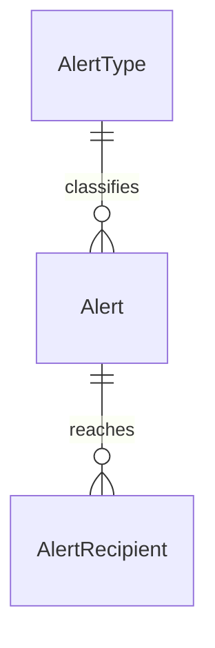

# Data Models per Service

## Service: Notification

**DB Engine:** SQL Server 16.

**Engine justification:**
- SQL Server provides transactional event, alert, and recipient state storage.
- Relational references and indexes support route-execution history and recipient queries.

### Table: Boarding

**Purpose:** Records boarding and alighting during route execution.

```sql
CREATE TABLE Boarding (
	Id UNIQUEIDENTIFIER PRIMARY KEY,
    RouteExecutionId UNIQUEIDENTIFIER NOT NULL,
    ProfileId UNIQUEIDENTIFIER NOT NULL,
    RouteStopId UNIQUEIDENTIFIER NOT NULL,
    DateTime DATETIME2 NOT NULL DEFAULT GETDATE(),
    BoardingType VARCHAR(20) NOT NULL CHECK (BoardingType IN ('ON_BOARD', 'OFF_BOARD')) DEFAULT 'ON_BOARD'
);
```

**Data dictionary:**

| Column | Type | Description | Example |
|--------|------|-------------|---------|
| Id | UNIQUEIDENTIFIER | Boarding event identifier | `550e8400-...` |
| RouteExecutionId | UNIQUEIDENTIFIER | Route trip reference | `550e8400-...` |
| ProfileId | UNIQUEIDENTIFIER | Student profile reference | `550e8400-...` |
| RouteStopId | UNIQUEIDENTIFIER | Stop and Route reference | `550e8400-...` |
| DateTime | DATETIME2 | Event timestamp | `2026-09-08T08:10:00Z` |
| Status | VARCHAR(20) | Lifecycle status | `Active` |
| BoardingType | BOARDINGTYPE | `ON_BOARD` or `OFF_BOARD` | `ON_BOARD` |

**Modeling decisions:**
1. One event table represents both boarding directions through `BoardingType`.
2. IDs from Route, Bus, and IAM are service correlations, not cross-schema joins.

### Table: AlertType

**Purpose:** Catalogs alert types and urgency.

```sql
CREATE TABLE AlertType (
    Id TINYINT PRIMARY KEY, 
    Name VARCHAR(30) NOT NULL, 
    Description VARCHAR(100) NOT NULL, 
    UrgencyLevel TINYINT NOT NULL, 
);
```

**Data dictionary:**

| Column | Type | Description | Example |
|--------|------|-------------|---------|
| Id | TINYINT | Alert type identifier | `1` |
| Name | VARCHAR(30) | Alert type name | `LateArrival` |
| Description | VARCHAR(100) | Alert description | `Bus is delayed` |
| UrgencyLevel | TINYINT | Numeric urgency | `3` |
| Status | VARCHAR(20) | Lifecycle status | `Active` |

**Modeling decisions:**
1. Numeric urgency supports deterministic prioritization.
2. Catalog status allows retiring alert types without losing history.

### Table: Alert

**Purpose:** Stores alerts raised during route executions.

```sql
CREATE TABLE Alert (
	Id UNIQUEIDENTIFIER PRIMARY KEY,
    RouteExecutionId UNIQUEIDENTIFIER NOT NULL,
    AlertTypeId TINYINT NOT NULL,
    ProfileId UNIQUEIDENTIFIER NOT NULL,
    DateTime DATETIME2 NOT NULL DEFAULT GETDATE(),
    Description VARCHAR(100), 
    AcknowledgedAt DATETIME2 NULL
);
```

**Data dictionary:**

| Column | Type | Description | Example |
|--------|------|-------------|---------|
| Id | UNIQUEIDENTIFIER | Alert identifier | `550e8400-...` |
| RouteExecutionId | UNIQUEIDENTIFIER | Route trip reference | `550e8400-...` |
| AlertTypeId | TINYINT | Alert catalog reference | `1` |
| ProfileId | UNIQUEIDENTIFIER | Reporting profile reference | `550e8400-...` |
| DateTime | DATETIME2 | Alert timestamp | `2026-09-08T08:15:00Z` |
| Description | VARCHAR(100) | Alert detail | `Traffic delay` |
| AcknowledgedAt | DATETIME2 | when someone attended to her | `2026-09-09T02:10:00Z` |
| Status | VARCHAR(20) | Lifecycle status | `Active` |

**Modeling decisions:**
1. `AlertTypeId` separates reusable urgency metadata from alert instances.
2. Route execution remains the correlation anchor for trip alerts.

### Table: AlertRecipient

**Purpose:** Tracks recipients and whether they read an alert.

```sql
CREATE TABLE AlertRecipient (
    Id UNIQUEIDENTIFIER PRIMARY KEY,
    AlertId UNIQUEIDENTIFIER NOT NULL,
    ProfileId UNIQUEIDENTIFIER NOT NULL,
    DateTimeRead DATETIME2 NOT NULL, 
);
```

**Data dictionary:**

| Column | Type | Description | Example |
|--------|------|-------------|---------|
| Id | UNIQUEIDENTIFIER | Recipient record identifier | `550e8400-...` |
| AlertId | UNIQUEIDENTIFIER | Alert reference | `550e8400-...` |
| ProfileId | UNIQUEIDENTIFIER | Recipient profile reference | `550e8400-...` |
| DateTimeRead | DATETIME2 | Read timestamp | `2026-09-08T08:20:00Z` |
| Status | VARCHAR(20) | Lifecycle status | `Active` |

**Modeling decisions:**
1. Read state is stored per profile so one alert can have many recipients.
2. `DateTimeRead` preserves delivery acknowledgement timing.

### Indexes

| Name | Fields | Type | Justification |
|------|--------|------|---------------|
| IX_Boarding_RouteExecutionId | RouteExecutionId | Nonclustered | Boarding events by trip |
| IX_Alert_RouteExecutionId | RouteExecutionId | Nonclustered | Alerts by trip |
| IX_AlertRecipient_ProfileId | ProfileId | Nonclustered | Recipient inbox lookup |
| IX_Alert_DateTime | DateTime | Nonclustered | Chronological alert lookup |

## Migration strategy

**Tool:** Versioned SQL Server migrations.

**File naming convention:** `V{Version}__{Description}.sql`

**Migration rules:**
1. Apply one forward-only logical change per migration.
2. Introduce new alert types through seed migrations.
3. Preserve event history and avoid destructive changes to referenced IDs.

```
Migrations are forward-only and immutable after execution.
Alert catalog seed data is versioned separately from structural changes.
Event history is retained; destructive changes require a two-phase rollout.
```

**Compatible schema changes (non-breaking):**

```sql
ALTER TABLE Alert ADD ExternalReference VARCHAR(100) NULL;
CREATE INDEX IX_Alert_DateTime ON Alert (DateTime);
CREATE INDEX IX_Boarding_RouteExecutionId ON Boarding (RouteExecutionId);
CREATE INDEX IX_Alert_RouteExecutionId ON Alert (RouteExecutionId);
CREATE INDEX IX_AlertRecipient_ProfileId ON AlertRecipient (ProfileId);
```

**Incompatible changes (require 2-phase migration):**

```sql
ALTER TABLE Alert ADD RaisedAt DATETIME2 NULL;
UPDATE Alert SET RaisedAt = DateTime;
ALTER TABLE Alert DROP COLUMN DateTime;
```

## DB engine selection guide

| Engine | Use when... | Avoid when... |
|--------|------------|---------------|
| **SQL Server** | ACID event, alert, recipient, and catalog records | Ephemeral counters or cache-only state |
| **PostgreSQL** | ACID transactions, complex relationships, JSONB, full-text search | Deeply nested documents |
| **MongoDB** | Flexible documents and catalog-style data | Complex transactions across collections |
| **Redis** | Cache, sessions, TTL state, and notification queues | Durable alert history or source-of-truth records |
| **Elasticsearch** | Full-text search, analytics, and operational logs | Authoritative notification data |

## Relationship diagram (per service)



## Correlations

- Authoritative source: `09-microservices/services/05-notification-service/data-model.md`
- Trip and stop correlations: `06-data/domain/route.md`
- Profile correlation: `06-data/domain/iam.md`
- Fleet correlation: `06-data/domain/bus.md`
