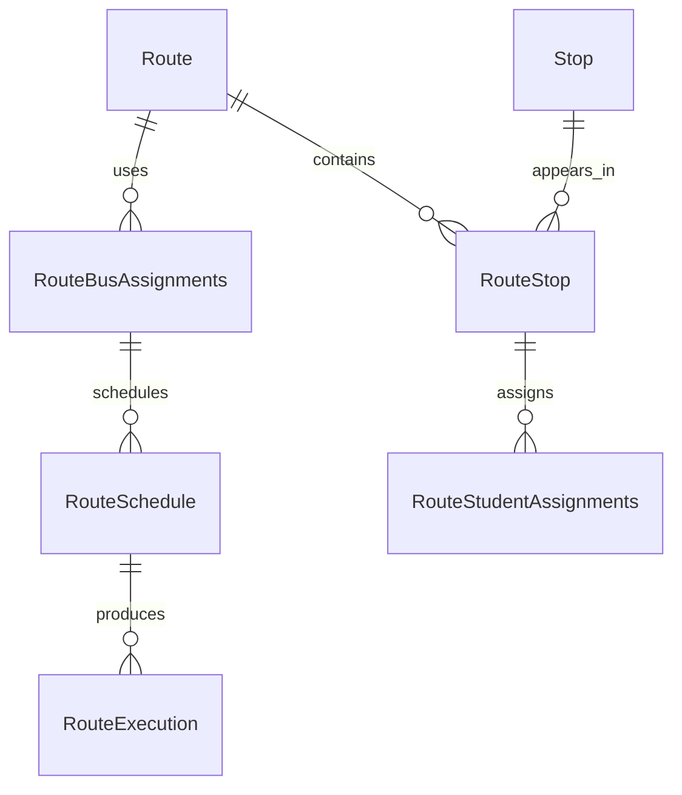

# Data Models per Service

## Service: Route

**DB Engine:** SQL Server 16.

**Engine justification:**
- SQL Server supports the relational route hierarchy, schedules, assignments, and executions.
- Foreign-key-shaped IDs and indexes support local relationships while external references remain service correlations.

### Table: Route

**Purpose:** Defines a bus route for a school.

```sql
CREATE TABLE Route (
    Id UNIQUEIDENTIFIER PRIMARY KEY,
    CampuseId UNIQUEIDENTIFIER NOT NULL,
    Name VARCHAR(30) NOT NULL, 
    TargetSector VARCHAR(30) NOT NULL, 
    Status VARCHAR(20) NOT NULL CHECK (Status IN ('Active', 'Inactive')) DEFAULT 'Active'
);
```

**Data dictionary:**

| Column | Type | Description | Example |
|--------|------|-------------|---------|
| Id | UNIQUEIDENTIFIER | Route identifier | `550e8400-...` |
| CampuseId | UNIQUEIDENTIFIER | School campus reference| `550e8400-...` |
| Name | VARCHAR(30) | Route name | `North Route` |
| TargetSector | VARCHAR(30) | Served sector | `North` |
| Status | VARCHAR(20) | Lifecycle status | `Active` |

**Modeling decisions:**
1. School ownership is represented by an external `SchoolID` correlation.
2. Status supports route retirement without removing execution history.

### Table: Stop

**Purpose:** Represents a pickup or drop-off location.

```sql
CREATE TABLE Stop (
    Id UNIQUEIDENTIFIER PRIMARY KEY,
    CityId UNIQUEIDENTIFIER NOT NULL,
    Address VARCHAR(30) NOT NULL, 
    Longitude DECIMAL(10,2) NOT NULL, 
    Latitude DECIMAL(10,2) NOT NULL, 
    Status VARCHAR(20) NOT NULL CHECK (Status IN ('Active', 'Inactive')) DEFAULT 'Active'
);
```

**Data dictionary:**

| Column | Type | Description | Example |
|--------|------|-------------|---------|
| Id | UNIQUEIDENTIFIER | Stop identifier | `550e8400-...` |
| CityId | UNIQUEIDENTIFIER | City correlation | `550e8400-...` |
| Address | VARCHAR(30) | Stop address | `10 Main St` |
| Longitude | DECIMAL(12,2) | Longitude | `-74.07` |
| Latitude | DECIMAL(12,2) | Latitude | `4.71` |
| Status | VARCHAR(20) | Lifecycle status | `Active` |

**Modeling decisions:**
1. Coordinates remain on the stop for route planning and lookup.
2. City and school IDs are resolved through service contracts.

### Table: RouteStop

**Purpose:** Orders stops within a route.

```sql
CREATE TABLE RouteStop (
    Id UNIQUEIDENTIFIER PRIMARY KEY,
    RouteId UNIQUEIDENTIFIER NOT NULL,
    StopId UNIQUEIDENTIFIER NOT NULL,
    OrderSequence INT NOT NULL,
    Status VARCHAR(20) NOT NULL CHECK (Status IN ('Active', 'Inactive')) DEFAULT 'Active'
);
```

**Data dictionary:**

| Column | Type | Description | Example |
|--------|------|-------------|---------|
| Id | UNIQUEIDENTIFIER | Route-stop identifier | `550e8400-...` |
| RouteId | UNIQUEIDENTIFIER | Route reference | `550e8400-...` |
| StopId | UNIQUEIDENTIFIER | Stop reference | `550e8400-...` |
| Order | INT | Sequence within route | `3` |
| Status | VARCHAR(20) | Lifecycle status | `Active` |

**Modeling decisions:**
1. The association stores order explicitly because a stop can occur on multiple routes.
2. `Order` is preserved as the source field name and quoted in SQL.

### Table: RouteBusAssignments

**Purpose:** Assigns buses to routes.

```sql
CREATE TABLE RouteBusAssignments (
    Id UNIQUEIDENTIFIER PRIMARY KEY,
    BusId UNIQUEIDENTIFIER NOT NULL,
    RouteId UNIQUEIDENTIFIER NOT NULL,
    Status VARCHAR(20) NOT NULL CHECK (Status IN ('Active', 'Inactive')) DEFAULT 'Active'
);
```

**Data dictionary:**

| Column | Type | Description | Example |
|--------|------|-------------|---------|
| Id | UNIQUEIDENTIFIER | Assignment identifier | `550e8400-...` |
| BusId | UNIQUEIDENTIFIER | assignment of the bus to the route | `550e8400-...` |
| RouteId | UNIQUEIDENTIFIER | Route reference | `550e8400-...` |
| Status | VARCHAR(20) | Lifecycle status | `Active` |

**Modeling decisions:**
1. A separate assignment allows bus changes without rewriting routes.
2. Bus ownership remains in the Bus service.

### Table: RouteStudentAssignments

**Purpose:** Assigns student profiles to route stops.

```sql
CREATE TABLE RouteStudentAssignments (
    Id UNIQUEIDENTIFIER PRIMARY KEY,
    ProfileId UNIQUEIDENTIFIER NOT NULL,
    RouteStopId UNIQUEIDENTIFIER NOT NULL,
    Status VARCHAR(20) NOT NULL CHECK (Status IN ('Active', 'Inactive')) DEFAULT 'Active'
);
```

**Data dictionary:**

| Column | Type | Description | Example |
|--------|------|-------------|---------|
| Id | UNIQUEIDENTIFIER | Assignment identifier | `550e8400-...` |
| ProfileId | UNIQUEIDENTIFIER | Student profile correlation | `550e8400-...` |
| RouteStopId | UNIQUEIDENTIFIER | Route-stop reference | `550e8400-...` |
| Status | VARCHAR(20) | Lifecycle status | `Active` |

**Modeling decisions:**
1. Assigning to `RouteStopID` captures both route and stop context.
2. Profile data remains owned by IAM.

### Table: RouteSchedule

**Purpose:** Defines weekly schedules for a route-bus assignment.

```sql
CREATE TABLE RouteSchedule (
    Id UNIQUEIDENTIFIER PRIMARY KEY,
    RouteBusAssignmentsId UNIQUEIDENTIFIER NOT NULL,
    DayOfWeek DayOfWeek NOT NULL (DayOfWeek IN ('Monday', 'Tuesday', 'Wednesday', 'Thursday', 'Friday')) DEFAULT 'Monday',
    Direction VARCHAR(10) NOT NULL, 
    StartTime TIME NOT NULL, 
    Status VARCHAR(20) NOT NULL CHECK (Status IN ('Active', 'Inactive')) DEFAULT 'Active'
);
```

**Data dictionary:**

| Column | Type | Description | Example |
|--------|------|-------------|---------|
| Id | UNIQUEIDENTIFIER | Schedule identifier | `550e8400-...` |
| RouteBusAssignmentsId | UNIQUEIDENTIFIER | Assignment reference | `550e8400-...` |
| DayOfWeek | DayOfWeek | Scheduled weekday | `MONDAY` |
| Direction | VARCHAR(10) | Trip direction | `OUTBOUND` |
| StartTime | TIME | Scheduled start | `07:00:00` |
| Status | VARCHAR(20) | Lifecycle status | `Active` |

**Modeling decisions:**
1. Day and direction model recurring plans without duplicating routes.
2. Execution records are kept separate from schedules.

### Table: RouteExecution

**Purpose:** Records each actual route trip.

```sql
CREATE TABLE RouteExecution (
    Id UNIQUEIDENTIFIER PRIMARY KEY,
    -- RouteScheduleId UNIQUEIDENTIFIER NOT NULL,
    BusId UNIQUEIDENTIFIER NOT NULL,
    DriverId UNIQUEIDENTIFIER NOT NULL,
    StartDateTime DATETIME2 NOT NULL, 
    EndDateTime DATETIME2 NOT NULL, 
    Status VARCHAR(20) NOT NULL CHECK (Status IN ('Active', 'Inactive')) DEFAULT 'Active'
);
```

**Data dictionary:**

| Column | Type | Description | Example |
|--------|------|-------------|---------|
| Id | UNIQUEIDENTIFIER | Execution identifier | `550e8400-...` |
| BusId | UNIQUEIDENTIFIER | bus running the route | `550e1200-...` |
| DriverId | UNIQUEIDENTIFIER | driver executing the route | `340e8400-...` |
| DayOfWeek | DAYOFWEEK | Execution weekday | `MONDAY` |
| StartDateTime | DATETIME2 | Execution start | `2026-09-08T07:00:00Z` |
| EndDateTime | DATETIME2 | Execution end | `2026-09-08T08:00:00Z` |
| Status | VARCHAR(20) | Lifecycle status | `Active` |

**Modeling decisions:**
1. Execution is the historical correlation anchor for boarding and alerts.
2. Start and end timestamps support trip duration analysis.

### Indexes

| Name | Fields | Type | Justification |
|--------|------|-------------|---------|
| IX_Route_SchoolId | SchoolId | Nonclustered | School route lookup |
| IX_RouteStop_RouteId | RouteId | Nonclustered | Ordered route stops |
| IX_RouteStop_StopId | StopId | Nonclustered | Stop route lookup |
| IX_RouteSchedule_RouteBusAssignmentsId | RouteBusAssignmentsId | Nonclustered | Schedule lookup |
| IX_RouteExecution_RouteScheduleId | RouteScheduleId | Nonclustered | Execution history |
| IX_RouteExecution_StartDateTime | StartDateTime | Nonclustered | Chronological execution lookup |

## Migration strategy

**Tool:** Versioned SQL Server migrations.

**File naming convention:** `V{Version}__{Description}.sql`

**Migration rules:**
1. Apply one forward-only logical change per migration.
2. Add new assignment fields compatibly before enforcing them.
3. Preserve execution history when route plans change.

```
Migrations are forward-only and immutable after execution.
Route plans and executions are changed through additive releases.
Execution history is retained when assignments or schedules change.
```

**Compatible schema changes (non-breaking):**

```sql
ALTER TABLE Route ADD Description VARCHAR(200) NULL;
CREATE INDEX IX_RouteExecution_StartDateTime ON RouteExecution (StartDateTime);
CREATE INDEX IX_Route_SchoolId ON Route (SchoolId);
CREATE INDEX IX_RouteStop_RouteId ON RouteStop (RouteId);
CREATE INDEX IX_RouteStop_StopId ON RouteStop (StopId);
CREATE INDEX IX_RouteSchedule_RouteBusAssignmentsId ON RouteSchedule (RouteBusAssignmentsId);
CREATE INDEX IX_RouteExecution_RouteScheduleId ON RouteExecution (RouteScheduleId);
```

**Incompatible changes (require 2-phase migration):**

```sql
ALTER TABLE RouteSchedule ADD DepartureTime TIME NULL;
UPDATE RouteSchedule SET DepartureTime = StartTime;
ALTER TABLE RouteSchedule DROP COLUMN StartTime;
```

## DB engine selection guide

| Engine | Use when... | Avoid when... |
|--------|------------|---------------|
| **SQL Server** | ACID route hierarchy, assignments, schedules, and executions | Ephemeral counters or unstructured documents |
| **PostgreSQL** | ACID transactions, complex relationships, JSONB, full-text search | Deeply nested documents |
| **MongoDB** | Flexible documents and catalog-style data | Complex transactions across collections |
| **Redis** | Cache, sessions, TTL state, and counters | Authoritative route plans or execution history |
| **Elasticsearch** | Full-text search, analytics, and logs | Source of truth for route data |

## Relationship diagram (per service)



## Correlations

- Authoritative source: `09-microservices/services/07-route-service/data-model.md`
- School and city correlations: `06-data/domain/school.md`
- Bus correlation: `06-data/domain/bus.md`
- Boarding and alert consumers: `06-data/domain/notification.md`
