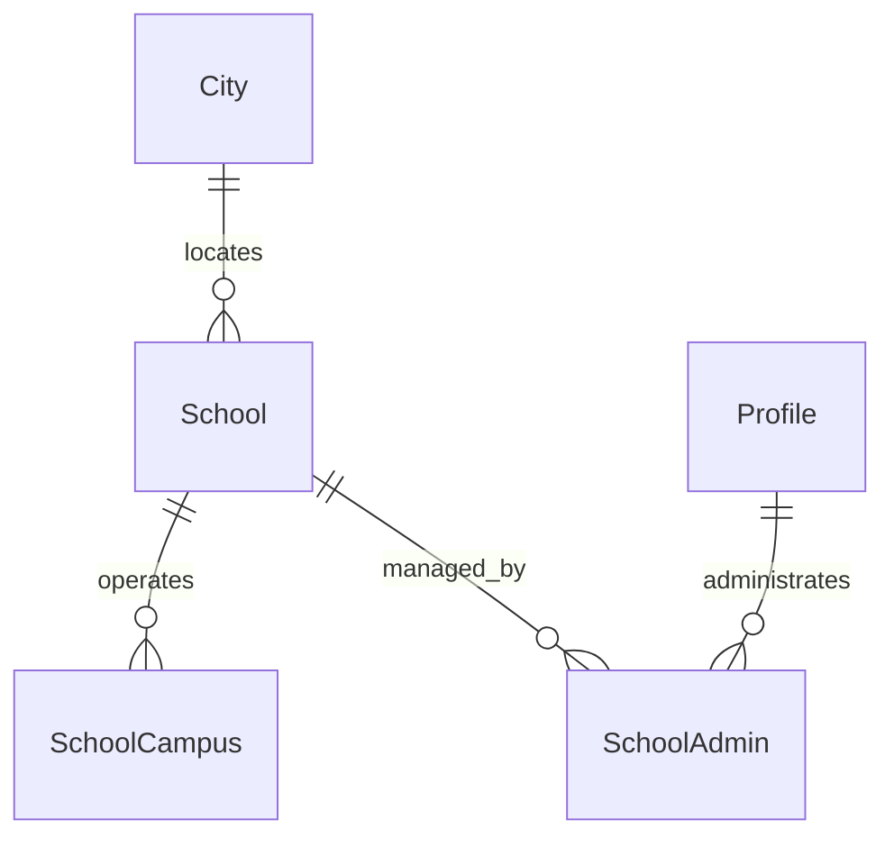

# Data Models per Service

## Service: School

**DB Engine:** SQL Server 16.

**Engine justification:**
- SQL Server supports transactional school and campus, reference data.
- Separate logical `School` schemas clarify ownership within the shared instance.

### Table: School

**Purpose:** Stores school registry information.

```sql
CREATE TABLE School (
    Id UNIQUEIDENTIFIER PRIMARY KEY,
    CityId UNIQUEIDENTIFIER NOT NULL,
    Logo (PENDING) NOT NULL,
    Name VARCHAR(30) NOT NULL,
    Address VARCHAR(30) NOT NULL,
    Phone INT NOT NULL,
    Email VARCHAR(50) NOT NULL,
    Website VARCHAR(100) NULL,
    Theme VARCHAR(20) NULL,
    Status VARCHAR(20) NOT NULL CHECK (Status IN ('Active', 'Inactive')) DEFAULT 'Active'
);
```

**Data dictionary:**

| Column | Type | Description | Example |
|--------|------|-------------|---------|
| Id | UNIQUEIDENTIFIER | School identifier | `550e8400-...` |
| CityId | UNIQUEIDENTIFIER | City reference | `550e8400-...` |
| Logo | (PENDING) | School logo content | `0x89504E47` |
| Name | VARCHAR(30) | School name | `Central School` |
| Address | VARCHAR(30) | School address | `10 Main St` |
| Phone | INT | Contact phone | `6015550100` |
| Email | VARCHAR(50) | Contact email | `office@example.edu` |
| Website | VARCHAR(100) | Website URL | `https://example.edu` |
| Theme | VARCHAR(20) | Visual theme | `Blue` |
| Status | VARCHAR(20) | Lifecycle status | `Active` |

**Modeling decisions:**
1. City ownership is isolated in the Geographic schema through `CityId`.
2. Optional contact and presentation fields preserve source flexibility.

### Table: SchoolCampus

**Purpose:** Represents physical campuses belonging to a school.

```sql
CREATE TABLE SchoolCampus (
    Id UNIQUEIDENTIFIER PRIMARY KEY,
    SchoolId UNIQUEIDENTIFIER NOT NULL,
    Name VARCHAR(30) NOT NULL, Address VARCHAR(30) NOT NULL, 
    Status VARCHAR(20) NOT NULL CHECK (Status IN ('Active', 'Inactive')) DEFAULT 'Active'
);
```

**Data dictionary:**

| Column | Type | Description | Example |
|--------|------|-------------|---------|
| Id | UNIQUEIDENTIFIER | Campus identifier | `550e8400-...` |
| SchoolId | UNIQUEIDENTIFIER | Parent school | `550e8400-...` |
| Name | VARCHAR(30) | Campus name | `North Campus` |
| Address | VARCHAR(30) | Campus address | `20 North St` |
| Status | VARCHAR(20) | Lifecycle status | `Active` |

**Modeling decisions:**
1. Campus is separate because a school can operate multiple locations.
2. Status supports campus closure while preserving enrollment history.

### Table: SchoolAdmin

**Purpose:** Links an administrator profile to the single school it manages.

```sql
CREATE TABLE School.SchoolAdmin (
    Id UNIQUEIDENTIFIER PRIMARY KEY,
    SchoolId UNIQUEIDENTIFIER NOT NULL,
    ProfileId UNIQUEIDENTIFIER NOT NULL,
    Status VARCHAR(20) NOT NULL CHECK (Status IN ('Active', 'Inactive')) DEFAULT 'Active',
    CONSTRAINT UQ_SchoolAdmin_Profile UNIQUE (ProfileId)
);
```

**Data dictionary:**

| Column | Type | Description | Example |
|--------|------|-------------|---------|
| Id | UNIQUEIDENTIFIER | Link identifier | `550e8400-...` |
| SchoolId | UNIQUEIDENTIFIER | Managed school | `550e8400-...` |
| ProfileId | UNIQUEIDENTIFIER | Administrator profile (Iam.Profile, unique: one school per admin) | `550e8400-...` |
| Status | VARCHAR(20) | Lifecycle status | `Active` |

**Modeling decisions:**
1. One admin manages exactly one school; `UQ_SchoolAdmin_Profile` enforces it in the database, not just in code.
2. Profile ownership stays in Iam; this table is only the school-side link.

### Indexes

| Name | Fields | Type | Justification |
|--------|--------|------|---------------|
| IX_School_CityId | CityId | Nonclustered | Geographic school lookup |
| IX_SchoolCampus_SchoolId | SchoolId | Nonclustered | Campus lookup |
| UQ_SchoolAdmin_Profile | ProfileId | Unique | One school per admin |

## Migration strategy

**Tool:** Versioned SQL Server migrations.

**File naming convention:** `V{Version}__{Description}.sql`

**Migration rules:**
1. Apply one forward-only logical change per migration.
2. Seed geographic reference data separately from schema changes.
3. Preserve schools and enrollments through status changes rather than destructive deletion.

```
Migrations are forward-only and immutable after execution.
Geographic seed data is deployed separately from structural changes.
Status changes preserve historical school and enrollment records.
```

**Compatible schema changes (non-breaking):**

```sql
ALTER TABLE School ADD EmergencyPhone VARCHAR(20) NULL;
CREATE INDEX IX_School_CityId ON School (CityId);
CREATE INDEX IX_SchoolCampus_SchoolId ON SchoolCampus (SchoolId);
```

**Incompatible changes (require 2-phase migration):**

```sql
ALTER TABLE School ADD SchoolName VARCHAR(60) NULL;
UPDATE School SET SchoolName = Name;
ALTER TABLE School DROP COLUMN Name;
```

## DB engine selection guide

| Engine | Use when... | Avoid when... |
|--------|------------|---------------|
| **SQL Server** | ACID transactions, school hierarchy, and geographic references | Ephemeral counters or unstructured documents |
| **MongoDB** | Flexible documents and catalog-style data | Complex transactions across collections |
| **Redis** | Cache, sessions, TTL state, and counters | Source of truth for schools or enrollments |
| **Elasticsearch** | Full-text search, analytics, and logs | Authoritative school data |

## Relationship diagram (per service)



## Correlations

- Authoritative source: `09-microservices/services/04-school-service/data-model.md`
- Profile correlation: `06-data/domain/iam.md`
- Route stop consumer: `06-data/domain/route.md`
- Fleet school reference: `06-data/domain/bus.md`
