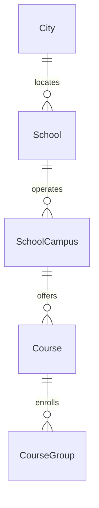

# Data Models per Service

## Service: School

**DB Engine:** SQL Server 15.

**Engine justification:**
- SQL Server supports transactional school, campus, course, and geographic reference data.
- Separate logical `School` and `Geographic` schemas clarify ownership within the shared instance.

### Table: School

**Purpose:** Stores school registry information.

```sql
CREATE TABLE School (
    Id UUID PRIMARY KEY, 
    CityId UUID NOT NULL, 
    Logo BYTE NOT NULL,
    Name VARCHAR(30) NOT NULL,
    Address VARCHAR(30) NOT NULL,
    Phone INT NOT NULL,
    Email VARCHAR(50) NOT NULL,
    Website VARCHAR(100) NOT NULL,
    Theme VARCHAR(20) NOT NULL,
    Status VARCHAR(20) NOT NULL CHECK (Status IN ('Active', 'Inactive')) DEFAULT 'Active'
);
```

**Data dictionary:**

| Column | Type | Description | Example |
|--------|------|-------------|---------|
| Id | UUID | School identifier | `550e8400-...` |
| CityId | UUID | City reference | `550e8400-...` |
| Logo | BYTE | School logo content | `0x89504E47` |
| Name | VARCHAR(30) | School name | `Central School` |
| Address | VARCHAR(30) | School address | `10 Main St` |
| Phone | INT | Contact phone | `6015550100` |
| Email | VARCHAR(50) | Contact email | `office@example.edu` |
| Website | VARCHAR(100) | Website URL | `https://example.edu` |
| Theme | VARCHAR(20) | Visual theme | `Blue` |
| Status | VARCHAR(20) | Lifecycle status | `Active` |

**Modeling decisions:**
1. City ownership is isolated in the Geographic schema through `CityId`.
2. Optional contact and presentation fields preserve source flexibility.

### Table: SchoolCampus

**Purpose:** Represents physical campuses belonging to a school.

```sql
CREATE TABLE SchoolCampus (
    Id UUID PRIMARY KEY, 
    SchoolId UUID NOT NULL, 
    Name VARCHAR(30) NOT NULL, Address VARCHAR(30) NOT NULL, 
    Status VARCHAR(20) NOT NULL CHECK (Status IN ('Active', 'Inactive')) DEFAULT 'Active'
);
```

**Data dictionary:**

| Column | Type | Description | Example |
|--------|------|-------------|---------|
| Id | UUID | Campus identifier | `550e8400-...` |
| SchoolId | UUID | Parent school | `550e8400-...` |
| Name | VARCHAR(30) | Campus name | `North Campus` |
| Address | VARCHAR(30) | Campus address | `20 North St` |
| Status | VARCHAR(20) | Lifecycle status | `Active` |

**Modeling decisions:**
1. Campus is separate because a school can operate multiple locations.
2. Status supports campus closure while preserving enrollment history.

### Table: Course

**Purpose:** Represents a course offered at a campus.

```sql
CREATE TABLE Course (
    Id UUID PRIMARY KEY, 
    CampusId UUID NOT NULL, 
    Name VARCHAR(10) NOT NULL, 
    Status VARCHAR(20) NOT NULL CHECK (Status IN ('Active', 'Inactive')) DEFAULT 'Active'
);
```

**Data dictionary:**

| Column | Type | Description | Example |
|--------|------|-------------|---------|
| Id | UUID | Course identifier | `550e8400-...` |
| CampusId | UUID | Campus reference | `550e8400-...` |
| Name | VARCHAR(10) | Course name or code | `5A` |
| Status | VARCHAR(20) | Lifecycle status | `Active` |

**Modeling decisions:**
1. Course is an offering; enrollment is represented separately by CourseGroup.
2. Campus ownership avoids duplicating school data.

### Table: CourseGroup

**Purpose:** Groups student profiles into a course.

```sql
CREATE TABLE CourseGroup (
    Id UUID PRIMARY KEY, 
    ProfileId UUID NOT NULL, 
    CourseId UUID NOT NULL, 
    Status VARCHAR(20) NOT NULL CHECK (Status IN ('Active', 'Inactive')) DEFAULT 'Active'
);
```

**Data dictionary:**

| Column | Type | Description | Example |
|--------|------|-------------|---------|
| Id | UUID | Enrollment identifier | `550e8400-...` |
| ProfileId | UUID | Student profile correlation | `550e8400-...` |
| CourseId | UUID | Course reference | `550e8400-...` |
| Status | VARCHAR(20) | Lifecycle status | `Active` |

**Modeling decisions:**
1. CourseGroup models enrollment without duplicating profile data.
2. Profile ownership remains in IAM.

### Table: City

**Purpose:** Provides geographic city reference data.

```sql
CREATE TABLE City (
    Id UUID PRIMARY KEY, 
    Name VARCHAR(40) NOT NULL, 
    Country VARCHAR(30) NOT NULL, 
    Status VARCHAR(20) NOT NULL CHECK (Status IN ('Active', 'Inactive')) DEFAULT 'Active'
);
```

**Data dictionary:**

| Column | Type | Description | Example |
|--------|------|-------------|---------|
| Id | UUID | City identifier | `550e8400-...` |
| Name | VARCHAR(40) | City name | `Bogota` |
| Country | VARCHAR(30) | Country name | `Colombia` |
| Status | VARCHAR(20) | Lifecycle status | `Active` |

**Modeling decisions:**
1. City is shared by School and correlated by Route without direct cross-service joins.
2. Status supports controlled reference-data retirement.

### Indexes

| Name | Fields | Type | Justification |
|--------|--------|------|---------------|
| IX_School_CityId | CityId | Nonclustered | Geographic school lookup |
| IX_SchoolCampus_SchoolId | SchoolId | Nonclustered | Campus lookup |
| IX_Course_CampusId | CampusId | Nonclustered | Campus course lookup |
| IX_CourseGroup_ProfileId | ProfileId | Nonclustered | Student course lookup |
| IX_Course_Name | Name | Nonclustered | Course name lookup |

## Migration strategy

**Tool:** Versioned SQL Server migrations.

**File naming convention:** `V{Version}__{Description}.sql`

**Migration rules:**
1. Apply one forward-only logical change per migration.
2. Seed geographic reference data separately from schema changes.
3. Preserve schools and enrollments through status changes rather than destructive deletion.

```
Migrations are forward-only and immutable after execution.
Geographic seed data is deployed separately from structural changes.
Status changes preserve historical school and enrollment records.
```

**Compatible schema changes (non-breaking):**

```sql
ALTER TABLE School ADD EmergencyPhone VARCHAR(20) NULL;
CREATE INDEX IX_Course_Name ON Course (Name);
CREATE INDEX IX_School_CityId ON School (CityId);
CREATE INDEX IX_SchoolCampus_SchoolId ON SchoolCampus (SchoolId);
CREATE INDEX IX_Course_CampusId ON Course (CampusId);
CREATE INDEX IX_CourseGroup_ProfileId ON CourseGroup (ProfileId);
```

**Incompatible changes (require 2-phase migration):**

```sql
ALTER TABLE School ADD SchoolName VARCHAR(60) NULL;
UPDATE School SET SchoolName = Name;
ALTER TABLE School DROP COLUMN Name;
```

## DB engine selection guide

| Engine | Use when... | Avoid when... |
|--------|------------|---------------|
| **SQL Server** | ACID transactions, school hierarchy, and geographic references | Ephemeral counters or unstructured documents |
| **PostgreSQL** | ACID transactions, complex relationships, JSONB, full-text search | Deeply nested documents |
| **MongoDB** | Flexible documents and catalog-style data | Complex transactions across collections |
| **Redis** | Cache, sessions, TTL state, and counters | Source of truth for schools or enrollments |
| **Elasticsearch** | Full-text search, analytics, and logs | Authoritative school data |

## Relationship diagram (per service)



## Correlations

- Authoritative source: `09-microservices/services/04-school-service/data-model.md`
- Profile correlation: `06-data/domain/iam.md`
- Route stop consumer: `06-data/domain/route.md`
- Fleet school reference: `06-data/domain/bus.md`
