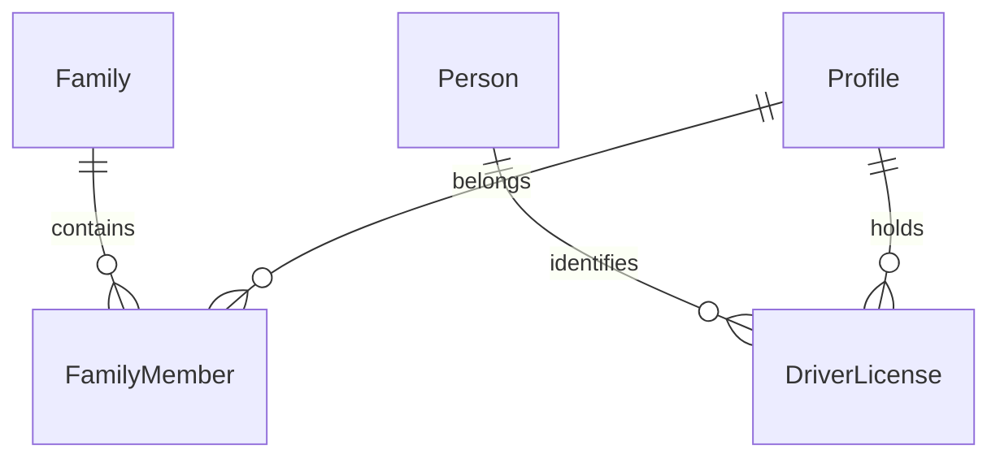

# Data Models per Service

## Service: UserManagement

**DB Engine:** SQL Server 15.

**Engine justification:**
- SQL Server supports transactional personal, family, relationship, and license records.
- Logical schema isolation protects personal-data ownership in the shared database.

### Table: Person

**Purpose:** Stores personal information for individuals.

```sql
CREATE TABLE Person (
    Id UUID PRIMARY KEY, 
    Name VARCHAR(50) NOT NULL, 
    LastName VARCHAR(50) NOT NULL, 
    IdentificationType VARCHAR(20) NOT NULL CHECK (IdentificationType IN ('TI', 'CC')) DEFAULT 'TI',
    IdentificationNumber VARCHAR(20) UNIQUE NOT NULL, 
    Email VARCHAR(50) NOT NULL, 
    Phone INT NOT NULL, 
    ResidenceAddress VARCHAR(50) NOT NULL, 
    DateBirth DATE NOT NULL, 
    Status VARCHAR(20) NOT NULL CHECK (Status IN ('Active', 'Inactive')) DEFAULT 'Active'
);
```

**Data dictionary:**

| Column | Type | Description | Example |
|--------|------|-------------|---------|
| Id | UUID | Person identifier | `550e8400-...` |
| Name | VARCHAR(50) | First name | `Ana` |
| LastName | VARCHAR(50) | Last name | `Garcia` |
| IdentificationType | VARCHAR(20) | Document type | `TI` |
| IdentificationNumber | VARCHAR(50) | Document number | `100200300` |
| Email | VARCHAR(50) | Email address | `ana@example.com` |
| Phone | INT | Phone number | `3005550100` |
| ResidenceAddress | VARCHAR(50) | Home address | `10 Main St` |
| DateBirth | DATE | Birth date | `2014-05-20` |
| Status | VARCHAR(20) | Lifecycle status | `Active` |

**Modeling decisions:**
1. Person owns personal data while IAM owns authentication context.
2. Identification number is unique to prevent duplicate identity records.

### Table: Family

**Purpose:** Groups related individuals.

```sql
CREATE TABLE Family (
    Id UUID PRIMARY KEY, 
    Name VARCHAR(50) NOT NULL, 
    Observations VARCHAR(100) NOT NULL, 
    Status VARCHAR(20) NOT NULL CHECK (Status IN ('Active', 'Inactive')) DEFAULT 'Active'
);
```

**Data dictionary:**

| Column | Type | Description | Example |
|--------|------|-------------|---------|
| Id | UUID | Family identifier | `550e8400-...` |
| Name | VARCHAR(50) | Family name or label | `Garcia Family` |
| Observations | VARCHAR(100) | Additional notes | `Shared pickup` |
| Status | VARCHAR(20) | Lifecycle status | `Active` |

**Modeling decisions:**
1. Family is a grouping entity rather than a duplicate person record.
2. Optional notes preserve operational context without changing membership.

### Table: FamilyMember

**Purpose:** Links profiles to families and records their relationship.

```sql
CREATE TABLE FamilyMember (
    Id UUID PRIMARY KEY, 
    FamilyId UUID NOT NULL, 
    ProfileId UUID NOT NULL, 
    RelationshipType VARCHAR(20) NOT NULL CHECK (RelationshipType IN ('Parent', 'Student')) DEFAULT 'Parent',
    Status VARCHAR(20) NOT NULL CHECK (Status IN ('Active', 'Inactive')) DEFAULT 'Active'
);
```

**Data dictionary:**

| Column | Type | Description | Example |
|--------|------|-------------|---------|
| Id | UUID | Membership identifier | `550e8400-...` |
| FamilyId | UUID | Family reference | `550e8400-...` |
| ProfileId | UUID | IAM profile correlation | `550e8400-...` |
| RelationshipType | VARCHAR(20) | `PARENT` or `STUDENT` | `PARENT` |
| Status | VARCHAR(20) | Lifecycle status | `Active` |

**Modeling decisions:**
1. The association supports many profiles per family and explicit relationship types.
2. Profile ownership remains in IAM and is resolved through contracts.

### Table: DriverLicense

**Purpose:** Stores driver-license information.

```sql
CREATE TABLE DriverLicense (
    Id UUID PRIMARY KEY, 
    ProfileId UUID NOT NULL, 
    LicenseNumber SMALLINT NOT NULL, 
    LicenseExpirationDate DATE NOT NULL, 
    Status VARCHAR(20) NOT NULL CHECK (Status IN ('Active', 'Inactive')) DEFAULT 'Active'
);
```

**Data dictionary:**

| Column | Type | Description | Example |
|--------|------|-------------|---------|
| Id | UUID | License record identifier | `550e8400-...` |
| ProfileId | UUID | Driver profile correlation | `550e8400-...` |
| LicenseNumber | SMALLINT | License number | `12345` |
| LicenseExpirationDate | DATE | Expiration date | `2028-12-31` |
| Status | VARCHAR(20) | Lifecycle status | `Active` |

**Modeling decisions:**
1. A separate license record permits license renewal without replacing the profile.
2. Profile ID is a cross-service correlation, not a direct join.

### Indexes

| Name | Fields | Type | Justification |
|--------|--------|------|-------------|
| UX_Person_IdentificationNumber | IdentificationNumber | Unique | Prevents duplicate identity documents |
| IX_Person_Email | Email | Nonclustered | Email lookup |
| IX_FamilyMember_FamilyId | FamilyId | Nonclustered | Family member lookup |
| IX_FamilyMember_ProfileId | ProfileId | Nonclustered | Profile family lookup |
| UX_DriverLicense_LicenseNumber | LicenseNumber | Unique | Identifies a driver license |

## Migration strategy

**Tool:** Versioned SQL Server migrations.

**File naming convention:** `V{Version}__{Description}.sql`

**Migration rules:**
1. Apply one forward-only logical change per migration.
2. Protect personal data with controlled, audited migrations.
3. Add optional personal attributes before making them mandatory.

```
Migrations are forward-only and immutable after execution.
Personal data migrations require controlled rollout and audit evidence.
Cross-service profile references are resolved through contracts.
```

**Compatible schema changes (non-breaking):**

```sql
ALTER TABLE Person ADD PreferredLanguage VARCHAR(20) NULL;
CREATE INDEX IX_Person_Email ON Person (Email);
CREATE UNIQUE INDEX UX_DriverLicense_LicenseNumber ON DriverLicense (LicenseNumber);
CREATE INDEX IX_FamilyMember_FamilyId ON FamilyMember (FamilyId);
CREATE INDEX IX_FamilyMember_ProfileId ON FamilyMember (ProfileId);
```

**Incompatible changes (require 2-phase migration):**

```sql
ALTER TABLE Person ADD FamilyName VARCHAR(50) NULL;
UPDATE Person SET FamilyName = LastName;
ALTER TABLE Person DROP COLUMN LastName;
```

## DB engine selection guide

| Engine | Use when... | Avoid when... |
|--------|------------|---------------|
| **SQL Server** | ACID transactions, personal-data integrity, and relational memberships | Ephemeral counters or cache-only state |
| **PostgreSQL** | ACID transactions, complex relationships, JSONB, full-text search | Deeply nested documents |
| **MongoDB** | Flexible documents and catalog-style data | Complex transactions across collections |
| **Redis** | Cache, sessions, TTL state, and counters | Authoritative personal data |
| **Elasticsearch** | Full-text search, analytics, and logs | Source of truth for personal records |

## Relationship diagram (per service)



## Correlations

- Authoritative source: `09-microservices/services/03-user-management-service/data-model.md`
- Profile and authentication correlation: `06-data/domain/iam.md`
- Privacy and security guidance: `00-governance/security-policy.md`
