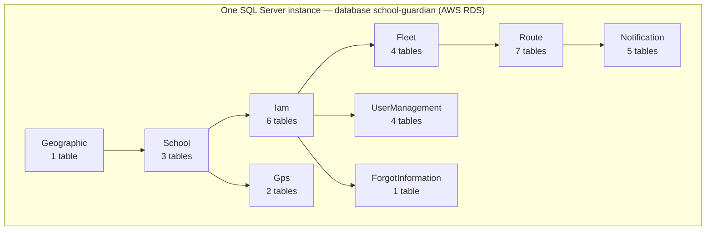
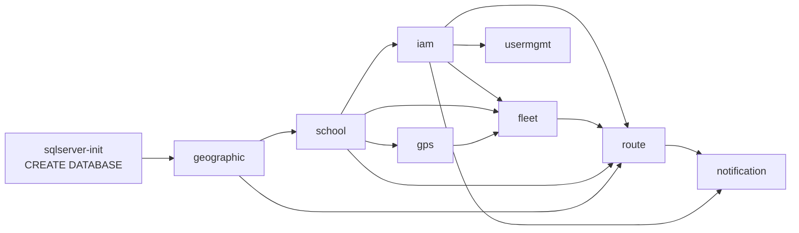

# Data Models per Service

> **Verified against the source of truth on 2026-10-22.**
> The authoritative artifact is the set of Liquibase changelogs in the `database/` repository
> (`ms-*-db/01-ddl/**`) plus, for `ForgotInformation`, the runtime schema initializer in
> `sg-ms-forgot-information`. Every table, column, constraint and FK below was read from those
> files — not from the application code and not from the old DBML sketch.
> **If this document and the database disagree, the database wins and this document is a bug.**

**Totals:** 1 database · 9 schemas · 33 tables (32 via Liquibase + 1 created at runtime).

---

## 0. Shape of the model (read this first)

There is **one SQL Server database** (`school-guardian`) with **one schema per microservice**
(ADR-002). There is **not** one database per service. All 8 Liquibase pipelines in
`database/docker-compose.yaml` point at the same `databaseName=school-guardian`, run in a
dependency-ordered chain, and each owns exactly one schema.



> **Foreign keys cross schemas deliberately.** The deployed model has **22 FKs** that cross a
> schema boundary (e.g. `Iam.Profile.PersonId` → `UserManagement.Person`). This is a conscious
> deviation from strict database-per-service that keeps referential integrity inside the single
> database. Services still never JOIN across schemas **in application code** — they talk over
> gRPC or Kafka. See ADR-002 and `05-architecture/overview.md` (principle P2).

### Deviations from this document's own conventions

This file used to prescribe audit columns (`created_at`, `updated_at`, `deleted_at`) and soft
delete on every table. **The deployed model does not follow that rule**, and per the source-of-
truth principle the rule is what bends:

| Convention (aspirational) | Deployed reality |
|---------------------------|------------------|
| `created_at` / `updated_at` / `deleted_at` on all tables | Not present. Only `Iam.TermsAcceptance.AcceptedAt`, `Route.*.StartDateTime/EndDateTime`, `Notification.*.DateTime`, `ForgotInformation.VerificationRequest` carry timestamps |
| Soft delete via `deleted_at` | Not used. Lifecycle is a `Status VARCHAR(20) CHECK IN ('Active','Inactive') DEFAULT 'Active'` column, present on 19 tables |
| Plural table names | Not used. Singular: `Route`, `Stop`, `Bus`, `Person`, `Alert` |
| Types `UUID`, `TIMESTAMPTZ` | `UNIQUEIDENTIFIER`, `DATETIME2` (SQL Server) |
| Liquibase rollbacks | None written. Every `05-rollbacks/` folder is an empty `.gitkeep`; evolution is forward-only `04-alter/` changesets plus compensating DML |

---

## 1. Global relationship diagram (all 33 tables)

Generated from the `04-alter/**-add-fk-*.sql` files in `database/`. **22 of these relationships
cross a schema boundary** (the rest are internal to their own schema).

```mermaid
erDiagram
    City ||--o{ School : "CityId"

    School ||--o{ SchoolCampus : "SchoolId"
    School ||--o{ SchoolAdmin : "SchoolId"
    Iam_Profile ||--o| SchoolAdmin : "ProfileId UQ"
    UserManagement_Person ||--o{ Iam_Profile : "PersonId"
    SchoolCampus ||--o{ Iam_Profile : "CampuseId"
    Iam_Role ||--o{ Iam_Profile : "RoleId"
    Iam_Profile ||--o{ Iam_SessionProfile : "ProfileId"
    Iam_Profile ||--o{ Iam_TermsAcceptance : "ProfileId"
    Iam_Profile ||--o{ Iam_TermsAcceptance : "StudentProfileId"
    Iam_Permissions ||--o{ Iam_PermissionsRole : "PermissionsId"
    Iam_Role ||--o{ Iam_PermissionsRole : "RoleId"
    SchoolCampus ||--o{ Fleet_Bus : "CampuseId"
    Gps_GpsDevice ||--o| Fleet_Bus : "GpsDeviceId unique one-to-one"
    Fleet_Model ||--o{ Fleet_Bus : "ModelId"
    Fleet_Brand ||--o{ Fleet_Model : "BrandId"
    Fleet_Bus ||--o{ Fleet_DriverAssignemts : "BusId"
    Iam_Profile ||--o{ Fleet_DriverAssignemts : "ProfileId"
    SchoolCampus ||--o{ Route_Route : "CampuseId"
    City ||--o{ Route_Stop : "CityId"
    School ||--o{ Route_Stop : "SchoolId"
    Route_Route ||--o{ Route_RouteStop : "RouteId"
    Route_Stop ||--o{ Route_RouteStop : "StopId"
    Route_Route ||--o{ Route_RouteBusAssignments : "RouteId"
    Fleet_Bus ||--o{ Route_RouteBusAssignments : "BusId"
    Route_RouteStop ||--o{ Route_RouteStudentAssignments : "RouteStopId"
    Iam_Profile ||--o{ Route_RouteStudentAssignments : "ProfileId"
    Route_RouteBusAssignments ||--o{ Route_RouteSchedule : "RouteBusAssignmentsId"
    Route_Route ||--o{ Route_RouteExecution : "RouteId"
    Fleet_Bus ||--o{ Route_RouteExecution : "BusId"
    Iam_Profile ||--o{ Route_RouteExecution : "DriverId"
    Route_RouteExecution ||--o{ Notification_Boarding : "RouteExecutionId"
    Route_RouteStop ||--o{ Notification_Boarding : "RouteStopId"
    Iam_Profile ||--o{ Notification_Boarding : "ProfileId"
    Route_RouteExecution ||--o{ Notification_Alert : "RouteExecutionId"
    Notification_AlertType ||--o{ Notification_Alert : "AlertTypeId"
    Iam_Profile ||--o{ Notification_Alert : "ProfileId"
    Notification_Alert ||--o{ Notification_AlertRecipient : "AlertId"
    Iam_Profile ||--o{ Notification_AlertRecipient : "ProfileId"
    Iam_Profile ||--o{ Notification_DeviceToken : "ProfileId (no FK)"
    Iam_Profile ||--o{ ForgotInformation_VerificationRequest : "ProfileId (no FK)"

    City {
        uniqueidentifier Id PK
        varchar Name
        varchar Country
        varchar Status
    }
    School {
        uniqueidentifier Id PK
        uniqueidentifier CityId FK
        varbinary Logo
        varchar Name
        varchar Address
        int Phone
        varchar Email
        varchar Website
        varchar Theme
        varchar Status
    }
    SchoolCampus {
        uniqueidentifier Id PK
        uniqueidentifier SchoolId FK
        varchar Name
        varchar Address
        varchar Status
    }
    SchoolAdmin {
        uniqueidentifier Id PK
        uniqueidentifier SchoolId FK
        uniqueidentifier ProfileId FK
        varchar Status
    }
    Iam_Role {
        tinyint Id PK
        varchar Name
        varchar Description
        varchar Status
    }
    Iam_Permissions {
        tinyint Id PK
        varchar TypePermissions
        varchar Description
    }
    Iam_PermissionsRole {
        tinyint Id PK
        tinyint PermissionsId FK
        tinyint RoleId FK
    }
    Iam_Profile {
        uniqueidentifier Id PK
        uniqueidentifier PersonId FK
        uniqueidentifier CampuseId FK
        varchar PasswordHash
        tinyint RoleId FK
        varchar Status
    }
    Iam_SessionProfile {
        int Id PK
        uniqueidentifier ProfileId FK
        datetime2 DateStart
        datetime2 DateEnd
        varchar IPAddress
        varchar StatusSession
    }
    Iam_TermsAcceptance {
        uniqueidentifier Id PK
        uniqueidentifier ProfileId FK
        uniqueidentifier StudentProfileId FK
        varchar TermsVersion
        datetime2 AcceptedAt
        varchar IpAddress
        varchar Channel
    }
    UserManagement_Person {
        uniqueidentifier Id PK
        varchar Name
        varchar LastName
        varchar IdentificationType
        varchar IdentificationNumber
        varchar Email
        bigint Phone
        varchar ResidenceAddress
        date DateBirth
        varchar Status
    }
    UserManagement_Family {
        uniqueidentifier Id PK
        varchar Name
        varchar Observations
        varchar Status
    }
    UserManagement_FamilyMember {
        uniqueidentifier Id PK
        uniqueidentifier FamilyId FK
        uniqueidentifier ProfileId FK
        varchar RelationshipType
        varchar Status
    }
    UserManagement_DriverLicense {
        uniqueidentifier Id PK
        uniqueidentifier ProfileId FK
        varchar LicenseNumber
        date LicenseExpirationDate
        varchar Status
    }
    Gps_GpsDevice {
        uniqueidentifier Id PK
        varchar Imei
        datetime2 LastConnection
        bit GpsStatus
    }
    Gps_GpsLocation {
        uniqueidentifier Id PK
        uniqueidentifier GpsDeviceId FK
        decimal Latitude
        decimal Longitude
        decimal Speed
        decimal Course
        datetime2 DateTime
    }
    Fleet_Brand {
        tinyint Id PK
        varchar Name
        varchar Status
    }
    Fleet_Model {
        tinyint Id PK
        tinyint BrandId FK
        varchar Name
        varchar Status
    }
    Fleet_Bus {
        uniqueidentifier Id PK
        uniqueidentifier CampuseId FK
        date SoatValidity
        uniqueidentifier GpsDeviceId FK
        tinyint Capacity
        varchar Plate
        tinyint ModelId FK
        varchar Status
    }
    Fleet_DriverAssignemts {
        uniqueidentifier Id PK
        uniqueidentifier ProfileId FK
        uniqueidentifier BusId FK
        date AssignedFrom
        date AssignedTo
    }
    Route_Route {
        uniqueidentifier Id PK
        uniqueidentifier CampuseId FK
        varchar Name
        varchar TargetSector
        time StartTime
        time EndTime
        varchar Status
    }
    Route_Stop {
        uniqueidentifier Id PK
        uniqueidentifier CityId FK
        uniqueidentifier SchoolId FK
        varchar Name
        varchar Address
        decimal Longitude
        decimal Latitude
        varchar Status
    }
    Route_RouteStop {
        uniqueidentifier Id PK
        uniqueidentifier RouteId FK
        uniqueidentifier StopId FK
        int OrderSequence
        varchar Status
    }
    Route_RouteBusAssignments {
        uniqueidentifier Id PK
        uniqueidentifier BusId FK
        uniqueidentifier RouteId FK
        varchar Status
    }
    Route_RouteStudentAssignments {
        uniqueidentifier Id PK
        uniqueidentifier ProfileId FK
        uniqueidentifier RouteStopId FK
        varchar Status
    }
    Route_RouteSchedule {
        uniqueidentifier Id PK
        uniqueidentifier RouteBusAssignmentsId FK
        varchar DayOfWeek
        varchar Direction
        time StartTime
        varchar Status
    }
    Route_RouteExecution {
        uniqueidentifier Id PK
        uniqueidentifier BusId FK
        uniqueidentifier DriverId FK
        uniqueidentifier RouteId FK
        datetime2 StartDateTime
        datetime2 EndDateTime
        varchar Direction
        varchar Status
    }
    Notification_AlertType {
        tinyint Id PK
        varchar Name
        varchar Description
        tinyint UrgencyLevel
    }
    Notification_Alert {
        uniqueidentifier Id PK
        uniqueidentifier RouteExecutionId FK
        tinyint AlertTypeId FK
        uniqueidentifier ProfileId FK
        datetime2 DateTime
        varchar Description
        datetime2 AcknowledgedAt
    }
    Notification_AlertRecipient {
        uniqueidentifier Id PK
        uniqueidentifier AlertId FK
        uniqueidentifier ProfileId FK
        datetime2 DateTimeRead
    }
    Notification_Boarding {
        uniqueidentifier Id PK
        uniqueidentifier RouteExecutionId FK
        uniqueidentifier ProfileId FK
        uniqueidentifier RouteStopId FK
        datetime2 DateTime
        varchar BoardingType
    }
    Notification_DeviceToken {
        uniqueidentifier Id PK
        uniqueidentifier ProfileId
        varchar ExpoToken
        datetime2 UpdatedAt
    }
    ForgotInformation_VerificationRequest {
        uniqueidentifier Id PK
        uniqueidentifier ProfileId
        varchar Purpose
        varchar Target
        varchar CodeHash
        varchar ResetTokenHash
        datetime2 ExpiresAt
        tinyint AttemptCount
        tinyint MaxAttempts
        varchar Status
        datetime2 CreatedAt
        datetime2 VerifiedAt
        datetime2 ConsumedAt
        varchar RequestIp
    }
```



> Entity names use `_` instead of `.` because Mermaid's ER syntax treats `.` as a separator.
> `Iam_Profile` = table `Profile` in schema `Iam`, and so on.

---

## 2. Schema: `Geographic`

**Owner:** none in the backend — deployed by `database/ms-geographic-db`, read directly by
`ms-school-management` and `ms-route`. **Tables: 1.**

### Table: `Geographic.City`

**Purpose:** Cities where schools and stops are located.

| Column | Type | Nullable | Constraints |
|--------|------|----------|-------------|
| Id | UNIQUEIDENTIFIER | NO | PK |
| Name | VARCHAR(40) | NO | — |
| Country | VARCHAR(30) | NO | — |
| Status | VARCHAR(20) | NO | CHECK IN ('Active','Inactive'), DEFAULT 'Active' |

---

## 3. Schema: `School`

**Owner:** `ms-school-management` (`school-management-service`). **Tables: 3.**

### Table: `School.School`

| Column | Type | Nullable | Constraints |
|--------|------|----------|-------------|
| Id | UNIQUEIDENTIFIER | NO | PK |
| CityId | UNIQUEIDENTIFIER | NO | **FK → Geographic.City** |
| Logo | VARBINARY(MAX) | NO | — |
| Name | VARCHAR(30) | NO | — |
| Address | VARCHAR(30) | NO | — |
| Phone | INT | NO | — |
| Email | VARCHAR(50) | NO | — |
| Website | VARCHAR(100) | YES | — |
| Theme | VARCHAR(20) | YES | — (supports FR-10.1) |
| Status | VARCHAR(20) | NO | CHECK, DEFAULT 'Active' |

### Table: `School.SchoolCampus`

**Purpose:** Campuses (sedes). The tenant key: `Iam.Profile`, `Fleet.Bus` and `Route.Route`
all point at a campus, not at a school.

| Column | Type | Nullable | Constraints |
|--------|------|----------|-------------|
| Id | UNIQUEIDENTIFIER | NO | PK |
| SchoolId | UNIQUEIDENTIFIER | NO | FK → School.School |
| Name | VARCHAR(30) | NO | — |
| Address | VARCHAR(30) | NO | — |
| Status | VARCHAR(20) | NO | CHECK, DEFAULT 'Active' |

### Table: `School.SchoolAdmin`

**Purpose:** Links an administrator profile to a school. `UQ_SchoolAdmin_Profile` enforces
**one admin = exactly one school**.

| Column | Type | Nullable | Constraints |
|--------|------|----------|-------------|
| Id | UNIQUEIDENTIFIER | NO | PK |
| SchoolId | UNIQUEIDENTIFIER | NO | FK → School.School |
| ProfileId | UNIQUEIDENTIFIER | NO | **FK → Iam.Profile, UNIQUE** |
| Status | VARCHAR(20) | NO | CHECK, DEFAULT 'Active' |

---

## 4. Schema: `Iam`

**Owner:** `ms-iam` (`iam-service`). **Tables: 6.**

### Table: `Iam.Role`

| Column | Type | Nullable | Constraints |
|--------|------|----------|-------------|
| Id | TINYINT | NO | PK IDENTITY |
| Name | VARCHAR(20) | NO | UNIQUE + index `IDX_Role_Name` |
| Description | VARCHAR(100) | NO | — |
| Status | VARCHAR(20) | NO | CHECK, DEFAULT 'Active' |

**Seeded roles (code enum, ids 1–5):** 1 = Admin, 2 = Student, 3 = Driver, 4 = Parent,
5 = SuperAdmin. *(A 6th "Auditor" role and its permissions were removed by compensating
DML deletes in `ms-iam-db/02-dml/02-deletes/`.)*

### Table: `Iam.Permissions`

| Column | Type | Nullable | Constraints |
|--------|------|----------|-------------|
| Id | TINYINT | NO | PK IDENTITY |
| TypePermissions | VARCHAR(100) | NO | — |
| Description | VARCHAR(150) | NO | — |

### Table: `Iam.PermissionsRole`

**Purpose:** Role ↔ permission join table.

| Column | Type | Nullable | Constraints |
|--------|------|----------|-------------|
| Id | TINYINT | NO | PK IDENTITY |
| PermissionsId | TINYINT | NO | FK → Iam.Permissions |
| RoleId | TINYINT | NO | FK → Iam.Role |

### Table: `Iam.Profile`

**Purpose:** The identity record: login, password hash, role and tenant. The JWT `sub` claim
is this table's `Id`.

| Column | Type | Nullable | Constraints |
|--------|------|----------|-------------|
| Id | UNIQUEIDENTIFIER | NO | PK |
| PersonId | UNIQUEIDENTIFIER | NO | **FK → UserManagement.Person** |
| CampuseId | UNIQUEIDENTIFIER | **YES** | **FK → School.SchoolCampus** — nullable since alter `005` (super-admin has no campus) |
| PasswordHash | VARCHAR(100) | NO | — |
| RoleId | TINYINT | NO | FK → Iam.Role |
| Status | VARCHAR(20) | NO | CHECK, DEFAULT 'Active' |

Index: `IDX_Profile_RoleId_PersonId (RoleId, PersonId)`.
> Column is really named **`CampuseId`** (sic) — the typo is part of the deployed schema.

### Table: `Iam.SessionProfile`

| Column | Type | Nullable | Constraints |
|--------|------|----------|-------------|
| Id | INT | NO | PK IDENTITY |
| ProfileId | UNIQUEIDENTIFIER | NO | FK → Iam.Profile |
| DateStart | DATETIME2 | NO | — |
| DateEnd | DATETIME2 | NO | — |
| IPAddress | VARCHAR(50) | NO | — |
| StatusSession | VARCHAR(50) | NO | — (no CHECK, no DEFAULT) |

### Table: `Iam.TermsAcceptance`

**Purpose:** Append-only proof of terms acceptance. `StudentProfileId` records a parent
accepting on behalf of a minor (HU/FR terms coverage).

| Column | Type | Nullable | Constraints |
|--------|------|----------|-------------|
| Id | UNIQUEIDENTIFIER | NO | PK |
| ProfileId | UNIQUEIDENTIFIER | NO | FK → Iam.Profile (who accepted) |
| StudentProfileId | UNIQUEIDENTIFIER | YES | FK → Iam.Profile (minor being covered) |
| TermsVersion | VARCHAR(20) | NO | — |
| AcceptedAt | DATETIME2 | NO | DEFAULT GETDATE() |
| IpAddress | VARCHAR(50) | YES | — |
| Channel | VARCHAR(20) | NO | DEFAULT 'mobile' |

---

## 5. Schema: `UserManagement`

**Owner:** `ms-user-management`. **Tables: 4.**

### Table: `UserManagement.Person`

**Purpose:** The person behind any account (student, driver, parent, admin). One row per human.

| Column | Type | Nullable | Constraints |
|--------|------|----------|-------------|
| Id | UNIQUEIDENTIFIER | NO | PK |
| Name | VARCHAR(50) | NO | — |
| LastName | VARCHAR(50) | NO | — |
| IdentificationType | VARCHAR(20) | NO | CHECK IN ('TI','CC'), DEFAULT 'TI' |
| IdentificationNumber | VARCHAR(20) | NO | **UNIQUE** |
| Email | VARCHAR(50) | NO | index `IDX_Person_Email` (not unique in DDL) |
| Phone | BIGINT | NO | index `IDX_Person_Phone` |
| ResidenceAddress | VARCHAR(50) | NO | — |
| DateBirth | DATE | NO | — |
| Status | VARCHAR(20) | NO | CHECK, DEFAULT 'Active' |

Indexes: `IDX_Person_Email`, `IDX_Person_Name`, `IDX_Person_LastName`,
`IDX_Person_IdentificationNumber`, `IDX_Person_Phone`.

### Table: `UserManagement.Family`

| Column | Type | Nullable | Constraints |
|--------|------|----------|-------------|
| Id | UNIQUEIDENTIFIER | NO | PK |
| Name | VARCHAR(50) | NO | — |
| Observations | VARCHAR(100) | NO | — |
| Status | VARCHAR(20) | NO | CHECK, DEFAULT 'Active' |

### Table: `UserManagement.FamilyMember`

**Purpose:** Links guardians and students to a family. Implements FR-1.4 (one guardian ↔ many
students). `RelationshipType` is constrained to the two real values.

| Column | Type | Nullable | Constraints |
|--------|------|----------|-------------|
| Id | UNIQUEIDENTIFIER | NO | PK |
| FamilyId | UNIQUEIDENTIFIER | NO | FK → UserManagement.Family |
| ProfileId | UNIQUEIDENTIFIER | NO | **FK → Iam.Profile** |
| RelationshipType | VARCHAR(20) | NO | CHECK IN ('Parent','Student'), DEFAULT 'Parent' |
| Status | VARCHAR(20) | NO | CHECK, DEFAULT 'Active' |

### Table: `UserManagement.DriverLicense`

| Column | Type | Nullable | Constraints |
|--------|------|----------|-------------|
| Id | UNIQUEIDENTIFIER | NO | PK |
| ProfileId | UNIQUEIDENTIFIER | NO | FK → Iam.Profile |
| LicenseNumber | VARCHAR(20) | NO | **UNIQUE** |
| LicenseExpirationDate | DATE | NO | — |
| Status | VARCHAR(20) | NO | CHECK, DEFAULT 'Active' |

---

## 6. Schema: `Fleet`

**Owner:** `ms-fleet` (`fleet-service`; docs legacy name `bus-service`). **Tables: 4.**

### Table: `Fleet.Brand`

| Column | Type | Nullable | Constraints |
|--------|------|----------|-------------|
| Id | TINYINT | NO | PK IDENTITY |
| Name | VARCHAR(30) | YES | — |
| Status | VARCHAR(20) | NO | CHECK, DEFAULT 'Active' |

### Table: `Fleet.Model`

| Column | Type | Nullable | Constraints |
|--------|------|----------|-------------|
| Id | TINYINT | NO | PK IDENTITY |
| BrandId | TINYINT | NO | FK → Fleet.Brand |
| Name | VARCHAR(30) | YES | — |
| Status | VARCHAR(20) | NO | CHECK, DEFAULT 'Active' |

### Table: `Fleet.Bus`

**Purpose:** A bus belongs to a campus and carries exactly one GPS device.
`GpsDeviceId` is **UNIQUE**, so the 1 bus ↔ 1 device relation is enforced by the database.

| Column | Type | Nullable | Constraints |
|--------|------|----------|-------------|
| Id | UNIQUEIDENTIFIER | NO | PK |
| CampuseId | UNIQUEIDENTIFIER | NO | **FK → School.SchoolCampus** |
| SoatValidity | DATE | NO | — |
| GpsDeviceId | UNIQUEIDENTIFIER | NO | **UNIQUE + FK → Gps.GpsDevice** |
| Capacity | TINYINT | NO | — (application enforces > 0) |
| Plate | VARCHAR(15) | NO | **UNIQUE** |
| ModelId | TINYINT | NO | FK → Fleet.Model |
| Status | VARCHAR(20) | NO | CHECK, DEFAULT 'Active' |

### Table: `Fleet.DriverAssignemts`

**Purpose:** A driver is responsible for one bus at a time (FR-3.6 / HU-BUS-002).
An open assignment has `AssignedTo = NULL`; the date closes it.

| Column | Type | Nullable | Constraints |
|--------|------|----------|-------------|
| Id | UNIQUEIDENTIFIER | NO | PK |
| ProfileId | UNIQUEIDENTIFIER | NO | FK → Iam.Profile |
| BusId | UNIQUEIDENTIFIER | NO | FK → Fleet.Bus |
| AssignedFrom | DATE | NO | DEFAULT GETDATE() |
| AssignedTo | DATE | YES | NULL = current assignment |

> Table name is really **`DriverAssignemts`** (sic) in the deployed schema.

---

## 7. Schema: `Route`

**Owner:** `ms-route`. **Tables: 7.**

### Table: `Route.Route`

| Column | Type | Nullable | Constraints |
|--------|------|----------|-------------|
| Id | UNIQUEIDENTIFIER | NO | PK |
| CampuseId | UNIQUEIDENTIFIER | NO | **FK → School.SchoolCampus** |
| Name | VARCHAR(30) | NO | — |
| TargetSector | VARCHAR(30) | NO | — |
| StartTime | TIME | NO | added by alter `008`, DEFAULT '00:00:00' |
| EndTime | TIME | NO | added by alter `008`, DEFAULT '00:00:00' |
| Status | VARCHAR(20) | NO | CHECK, DEFAULT 'Active' |

### Table: `Route.Stop`

| Column | Type | Nullable | Constraints |
|--------|------|----------|-------------|
| Id | UNIQUEIDENTIFIER | NO | PK |
| CityId | UNIQUEIDENTIFIER | NO | **FK → Geographic.City** |
| SchoolId | UNIQUEIDENTIFIER | NO | **FK → School.School** |
| Name | VARCHAR(30) | NO | added by alter `008`, DEFAULT '' |
| Address | VARCHAR(100) | NO | widened 30→100 by alter `008` |
| Longitude | DECIMAL(10,7) | NO | retyped DECIMAL(12,2)→(10,7) by alter `008` |
| Latitude | DECIMAL(10,7) | NO | retyped by alter `008` |
| Status | VARCHAR(20) | NO | CHECK, DEFAULT 'Active' |

### Table: `Route.RouteStop`

**Purpose:** The ordered stop sequence of a route (`OrderSequence` drives boarding/alighting
order).

| Column | Type | Nullable | Constraints |
|--------|------|----------|-------------|
| Id | UNIQUEIDENTIFIER | NO | PK |
| RouteId | UNIQUEIDENTIFIER | NO | FK → Route.Route |
| StopId | UNIQUEIDENTIFIER | NO | FK → Route.Stop |
| OrderSequence | INT | NO | — |
| Status | VARCHAR(20) | NO | CHECK, DEFAULT 'Active' |

### Table: `Route.RouteBusAssignments`

**Purpose:** One bus per route, one route per bus (FR-3.5).

| Column | Type | Nullable | Constraints |
|--------|------|----------|-------------|
| Id | UNIQUEIDENTIFIER | NO | PK |
| BusId | UNIQUEIDENTIFIER | NO | **FK → Fleet.Bus** |
| RouteId | UNIQUEIDENTIFIER | NO | FK → Route.Route |
| Status | VARCHAR(20) | NO | CHECK, DEFAULT 'Active' |

### Table: `Route.RouteStudentAssignments`

**Purpose:** A student assigned to a specific stop of a route (FR-3.7); the same stop is used
for boarding and alighting.

| Column | Type | Nullable | Constraints |
|--------|------|----------|-------------|
| Id | UNIQUEIDENTIFIER | NO | PK |
| ProfileId | UNIQUEIDENTIFIER | NO | FK → Iam.Profile |
| RouteStopId | UNIQUEIDENTIFIER | NO | FK → Route.RouteStop |
| Status | VARCHAR(20) | NO | CHECK, DEFAULT 'Active' |

### Table: `Route.RouteSchedule`

| Column | Type | Nullable | Constraints |
|--------|------|----------|-------------|
| Id | UNIQUEIDENTIFIER | NO | PK |
| RouteBusAssignmentsId | UNIQUEIDENTIFIER | NO | FK → Route.RouteBusAssignments |
| DayOfWeek | VARCHAR(10) | NO | CHECK IN (Monday…Friday), DEFAULT 'Monday' |
| Direction | VARCHAR(10) | NO | — |
| StartTime | TIME | NO | — |
| Status | VARCHAR(20) | NO | CHECK, DEFAULT 'Active' |

### Table: `Route.RouteExecution`

**Purpose:** One run (trip) of a route — the anchor for boardings, alerts and incidents.
`EndDateTime = NULL` means the trip is still in progress; `Direction` (alter `010`) models the
Ida/Vuelta round trip.

| Column | Type | Nullable | Constraints |
|--------|------|----------|-------------|
| Id | UNIQUEIDENTIFIER | NO | PK |
| BusId | UNIQUEIDENTIFIER | NO | **FK → Fleet.Bus** |
| DriverId | UNIQUEIDENTIFIER | NO | FK → Iam.Profile |
| RouteId | UNIQUEIDENTIFIER | **YES** | FK → Route.Route — added by alter `009` |
| StartDateTime | DATETIME2 | NO | — |
| EndDateTime | DATETIME2 | **YES** | made nullable by alter `009`; NULL = in progress |
| Direction | VARCHAR(10) | NO | added by alter `010`, DEFAULT 'Ida' |
| Status | VARCHAR(20) | NO | CHECK, DEFAULT 'Active' |

---

## 8. Schema: `Notification`

**Owner:** `ms-notification`. **Tables: 5.**

### Table: `Notification.AlertType`

**Purpose:** Catalog of alert kinds with an urgency level. The 20 operational types are seeded
by DML; incident types (Accident, Medical Emergency, Mechanical Breakdown, Security Incident)
were added later as data.

| Column | Type | Nullable | Constraints |
|--------|------|----------|-------------|
| Id | TINYINT | NO | PK IDENTITY |
| Name | VARCHAR(30) | NO | — |
| Description | VARCHAR(100) | NO | — |
| UrgencyLevel | TINYINT | NO | — (no CHECK) |

### Table: `Notification.Alert`

**Purpose:** The single alert entity. Boarding, alighting **and incidents** are all rows here —
an incident is an `Alert` whose `AlertType` is an incident type, with the free text in
`Description` (widened 100→500 by alter `004` for FR-8.1).

| Column | Type | Nullable | Constraints |
|--------|------|----------|-------------|
| Id | UNIQUEIDENTIFIER | NO | PK |
| RouteExecutionId | UNIQUEIDENTIFIER | NO | **FK → Route.RouteExecution** |
| AlertTypeId | TINYINT | NO | FK → Notification.AlertType |
| ProfileId | UNIQUEIDENTIFIER | NO | FK → Iam.Profile (who generated it) |
| DateTime | DATETIME2 | NO | DEFAULT GETDATE() |
| Description | VARCHAR(500) | YES | widened 100→500 by alter `004` |
| AcknowledgedAt | DATETIME2 | YES | NULL = unacknowledged |

### Table: `Notification.AlertRecipient`

**Purpose:** One row per notified profile (guardians of students on board, school admins).

| Column | Type | Nullable | Constraints |
|--------|------|----------|-------------|
| Id | UNIQUEIDENTIFIER | NO | PK |
| AlertId | UNIQUEIDENTIFIER | NO | FK → Notification.Alert |
| ProfileId | UNIQUEIDENTIFIER | NO | FK → Iam.Profile |
| DateTimeRead | DATETIME2 | NO | — |

### Table: `Notification.Boarding`

**Purpose:** Each boarding (`ON_BOARD`) or alighting (`OFF_BOARD`) event of a student.

| Column | Type | Nullable | Constraints |
|--------|------|----------|-------------|
| Id | UNIQUEIDENTIFIER | NO | PK |
| RouteExecutionId | UNIQUEIDENTIFIER | NO | **FK → Route.RouteExecution** |
| ProfileId | UNIQUEIDENTIFIER | NO | FK → Iam.Profile (the student) |
| RouteStopId | UNIQUEIDENTIFIER | NO | **FK → Route.RouteStop** |
| DateTime | DATETIME2 | NO | DEFAULT GETDATE() |
| BoardingType | VARCHAR(20) | NO | CHECK IN ('ON_BOARD','OFF_BOARD'), DEFAULT 'ON_BOARD' |

### Table: `Notification.DeviceToken`

**Purpose:** Expo push tokens, one per device, used by the `student.scanned` and
`incident.reported` consumers.

| Column | Type | Nullable | Constraints |
|--------|------|----------|-------------|
| Id | UNIQUEIDENTIFIER | NO | PK |
| ProfileId | UNIQUEIDENTIFIER | NO | **no FK constraint** — references `Iam.Profile` by convention only |
| ExpoToken | VARCHAR(300) | NO | UNIQUE `UQ_DeviceToken_ExpoToken` |
| UpdatedAt | DATETIME2 | NO | DEFAULT GETDATE() |

> ⚠️ **Known modeling gap:** every other `ProfileId` in the model has an FK; this one does not.
> Tracked in `04-requirements/traceability-matrix.md`.

---

## 9. Schema: `Gps`

**Owner:** `sg-ms-gps` (`gps-service`). **Tables: 2.**

> **State note (2026-10-22):** both tables are deployed by `database/ms-gps-db`, but
> `sg-ms-gps` does **not** write to them yet — device state and positions are held in memory.
> `Gps.GpsDevice` rows are currently created from `ms-fleet` when a bus is registered.
> `Gps.GpsLocation` is **empty** in the deployed database. See HU-GPS-002 / FR-6.1.

### Table: `Gps.GpsDevice`

| Column | Type | Nullable | Constraints |
|--------|------|----------|-------------|
| Id | UNIQUEIDENTIFIER | NO | PK |
| Imei | VARCHAR(20) | NO | **UNIQUE** |
| LastConnection | DATETIME2 | NO | — |
| GpsStatus | BIT | NO | — |

### Table: `Gps.GpsLocation`

| Column | Type | Nullable | Constraints |
|--------|------|----------|-------------|
| Id | UNIQUEIDENTIFIER | NO | PK |
| GpsDeviceId | UNIQUEIDENTIFIER | NO | FK → Gps.GpsDevice (added by alter `001`) |
| Latitude | DECIMAL(10,7) | NO | — |
| Longitude | DECIMAL(10,7) | NO | — |
| Speed | DECIMAL(8,2) | NO | — |
| Course | DECIMAL(8,2) | NO | — |
| DateTime | DATETIME2 | NO | — |

---

## 10. Schema: `ForgotInformation`

**Owner:** `sg-ms-forgot-information`. **Tables: 1.**

> ⚠️ **Not managed by Liquibase.** There is no `ms-forgot-information-db` folder in
> `database/`. The schema and table are created by `VerificationRequestSchemaInitializer` at
> service startup. This is the one place where the service — not the migrations — owns the DDL,
> and it should eventually be moved into `database/` for consistency (ADR-009).

### Table: `ForgotInformation.VerificationRequest`

**Purpose:** One row per OTP challenge (password reset, email change, phone change).
Read from the EF Core entity `VerificationRequestEntity` / `VerificationRequest`.

| Column | Type | Nullable | Constraints |
|--------|------|----------|-------------|
| Id | UNIQUEIDENTIFIER | NO | PK |
| ProfileId | UNIQUEIDENTIFIER | NO | **no FK constraint** — references `Iam.Profile` by convention |
| Purpose | VARCHAR/enum | NO | password-reset / email-change / phone-change |
| Target | VARCHAR | NO | destination email or phone the code was sent to |
| CodeHash | VARCHAR | NO | OTP hashed with `Otp:HashPepper` (never stored in clear) |
| ResetTokenHash | VARCHAR | YES | set once the code is verified; consumed on reset |
| ExpiresAt | DATETIME2 | NO | indexed |
| AttemptCount | TINYINT | NO | — |
| MaxAttempts | TINYINT | NO | — |
| Status | VARCHAR/enum | NO | Pending → Verified → Consumed (forward-only) |
| CreatedAt | DATETIME2 | NO | — |
| VerifiedAt | DATETIME2 | YES | — |
| ConsumedAt | DATETIME2 | YES | — |
| RequestIp | VARCHAR | NO | per-IP rate limiting / audit |

Indexes on `ProfileId`, `Purpose`, `Status` and `ExpiresAt`.

---

## 11. Migration strategy

**Tool:** Liquibase 4.29, one pipeline per schema, run as one-shot containers.

**Repository layout** (`database/ms-*-db/`):

```
changelog/changelog-master.yaml
01-ddl/01-schema/  02-types/  03-tables/  04-alter/  05-view/  06-functions/
   07-procedure/   08-triggers/  09-indexes/
02-dml/  03-dcl/  04-tcl/  05-rollbacks/
```

**Execution order** (from `depends_on` in `database/docker-compose.yaml`):



**Rules in force:**

1. Changesets are immutable once applied — never edit a deployed body, add a new version.
2. Evolution is **forward-only** through `04-alter/` + compensating DML; there are **no
   rollback files** (`05-rollbacks/` is empty in all 8 schemas).
3. Where a change must be reworked, compensating DML is used instead of editing history
   (example: the discontinued `Auditor` role and `audit.read`/`settings.manage` permissions were
   removed with deletes in `ms-iam-db/02-dml/02-deletes/`).
4. `sqlserver-init` creates the database idempotently before the first pipeline.

**Recorded schema evolution:**

| Schema | Change | Changeset |
|--------|--------|-----------|
| Iam | `Profile.CampuseId` NOT NULL → nullable (super-admin without campus) | `ms-iam-db 04-alter/005` |
| Gps | `GpsLocation.GpsDeviceId` FK added | `ms-gps-db 04-alter/001` |
| Fleet | `Bus.CampuseId` and `Bus.GpsDeviceId` FKs | `ms-fleet-db 04-alter/001` |
| Route | `Stop.Name` added, `Address` widened to 100, lat/long retyped to DECIMAL(10,7); `Route.StartTime/EndTime` added | `ms-route-db 04-alter/008` |
| Route | `RouteExecution.RouteId` added + `EndDateTime` nullable (in-progress trips) | `ms-route-db 04-alter/009` |
| Route | `RouteExecution.Direction` added, DEFAULT 'Ida' (round trip) | `ms-route-db 04-alter/010` |
| Notification | `Alert.Description` widened 100 → 500 (FR-8.1 free text) | `ms-notification-db 04-alter/004` |

---

## 12. Known modeling debts

| # | Debt | Impact | Suggested action |
|---|------|--------|------------------|
| 1 | `Notification.DeviceToken.ProfileId` has **no FK** | Orphan push tokens are possible | Add FK in a new `04-alter` changeset |
| 2 | `ForgotInformation.VerificationRequest` is **not in Liquibase** | DDL drifts from the migration pipeline | Port the schema initializer into `database/ms-forgot-information-db` (ADR-009) |
| 3 | `ForgotInformation.VerificationRequest.ProfileId` has **no FK** | Same as #1 | Add FK once #2 lands |
| 4 | Typos baked into the schema: `DriverAssignemts`, `CampuseId` | Any tooling or join written by a human will get it wrong | Either document forever (rename is a breaking change) or rename with expand→contract |
| 5 | No audit columns (`created_at`/`updated_at`) and no soft delete | Limited forensic trail; `Status='Inactive'` is the only lifecycle signal | Accept for MVP, or add columns going forward — do not retrofit silently |
| 6 | `Person.Email` is indexed but **not unique** | Two people could share an email | Decide whether email must be unique per tenant and add the constraint |
| 7 | `db-school-guardian.dbml` at the repo root diverges from the DDL (unique email, `StatusSession` default) | Two "truths" in one repo | Regenerate the DBML from the migrations or delete it |

---

## DB engine selection guide

| Engine | Use when... | Avoid when... |
|--------|------------|---------------|
| **SQL Server** *(in use)* | ACID transactions, RBAC relationships, shared schemas | Ephemeral counters or unstructured event streams |
| **MongoDB** | Flexible documents and catalog-style data | Complex transactions across collections |
| **Elasticsearch** | Full-text search, analytics, and logs | Authoritative identity data |

---

## Correlations

| Document | Relationship |
|----------|--------------|
| `domain/*.md` | Narrative model per domain (older; this file supersedes them on facts) |
| `data-dictionary.md` | Ambiguous / PII field meanings |
| `modeling-conventions.md` | Naming, keys, timestamps (aspirational — see deviations table) |
| `normalization-assessment.md` | Intentional denormalization |
| `migration-strategy.md` | Liquibase / expand-contract |
| `07-api/contracts/` | What each service exposes |
| `08-uml/diagram-index.md` | ER / sequence diagrams registry |
| `09-microservices/service-catalog.md` | Schema ↔ owning service |
| `09-microservices/services/*/data-model.md` | Service-owned summary |
