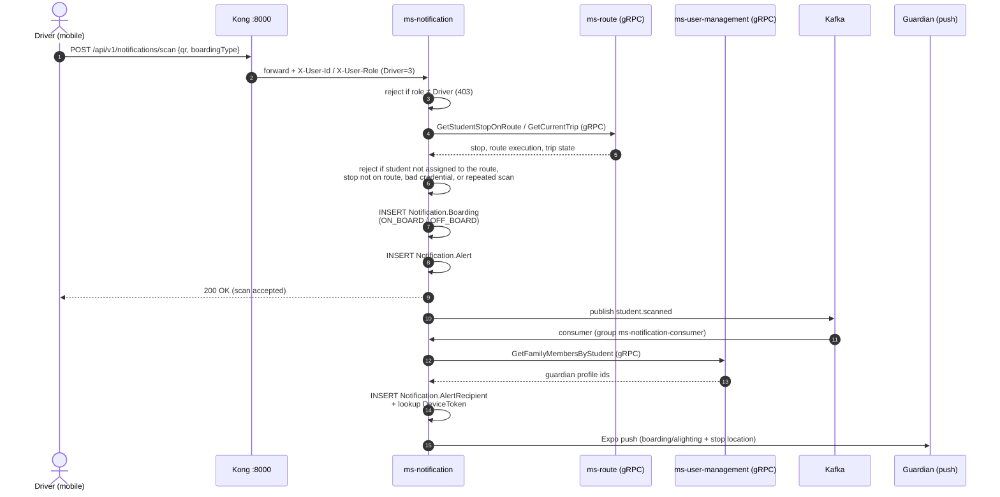
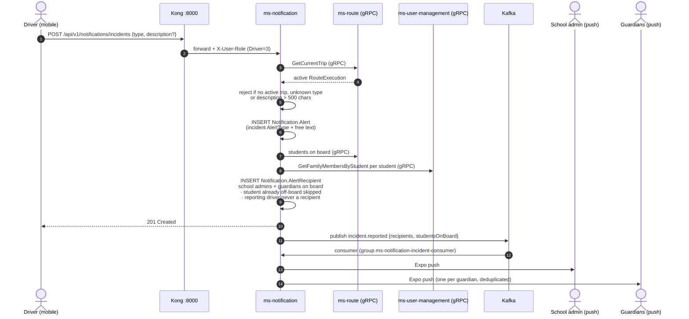
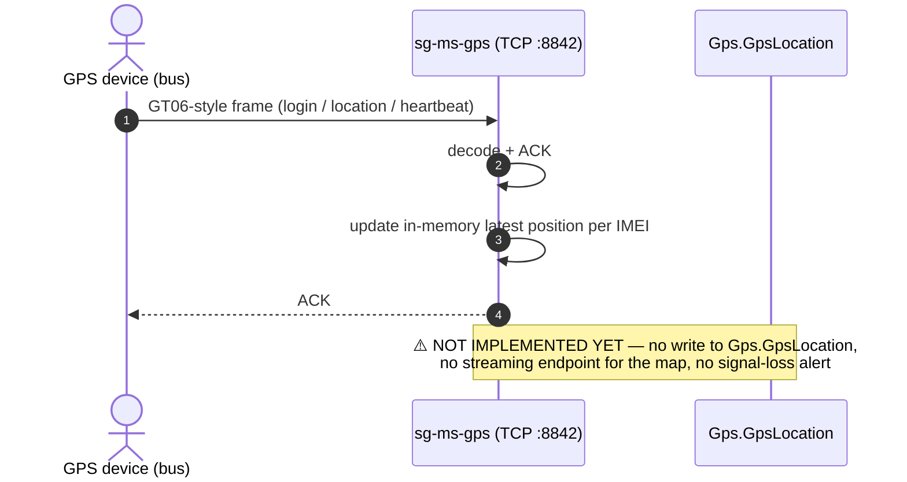

# Communication patterns

Last updated: 2026-10-22 · Sync: **gRPC** (ADR-005) · Async: **Kafka** (ADR-004) · Edge: **Kong :8000** → services **:8080**

## Decision table

| Scenario | Pattern | Why |
|----------|---------|-----|
| UI needs response now | HTTP via Kong → service | Public REST/OpenAPI |
| Service needs result from another service, low latency | **gRPC** | Typed, efficient (ADR-005) |
| Fan-out, decoupling, audit trail, retry | **Kafka** | Durable, replay (ADR-004) |
| Same request must join two services for one screen | API composition in caller / BFF later | No cross-schema join (ADR-002) |
| Real-time vehicle push to clients | WebSocket/SSE at edge or poll GPS API | Separate from gRPC mesh |

## Rules

1. **No** shared table writes across schemas.
2. Prefer **idempotent** consumers; include event id.
3. Timeouts + circuit breakers on gRPC callers.
4. Never call another service on a synchronous path without a failure plan.
5. Dual-write to Kafka via outbox when DB commit must match event publish.

## Patterns in use

### Request/response (edge)

```text
Client → Kong :8000 → <service>:8080 (Docker DNS)
```

### Sync service-to-service

```text
service-a → gRPC → service-b:8080
```

### Async domain event

```text
service-a DB commit → outbox → Kafka → service-b consumer
```

## Real flows (as implemented)

> Verified against the code on 2026-10-22. These are the two flows that combine **all three**
> channels at once (edge REST + internal gRPC + Kafka), which is why they are worth diagramming.

### Flow A — QR boarding / alighting (FR-4.2, FR-4.3, FR-5.1, FR-5.2, FR-5.3)

The driver's scan is the trigger; the guardian's push notification is the outcome. Note that
`ms-notification` produces **and** consumes its own event — the HTTP request returns fast and
the fan-out happens asynchronously.



**Persistence touched:** `Notification.Boarding`, `Notification.Alert`, `Notification.AlertRecipient`.

### Flow B — Incident report (FR-8.1, FR-8.2)

An incident is an `Alert` whose `AlertType` is an incident type. Same split: validate and
persist synchronously, notify asynchronously.



**Persistence touched:** `Notification.Alert`, `Notification.AlertRecipient`
(incidents have **no dedicated table** — see `06-data/models.md`).

### Flow C — GPS ingestion (FR-6.1, **partial**)

The only flow that does **not** go through Kong or Kafka: devices talk raw TCP straight to
`sg-ms-gps`. Positions currently stop in memory, which is the open gap behind HU-GPS-002.



## Related

- [event-catalog.md](./event-catalog.md)
- [service-catalog.md](./service-catalog.md)
- [service-boundary-rules.md](./service-boundary-rules.md)
