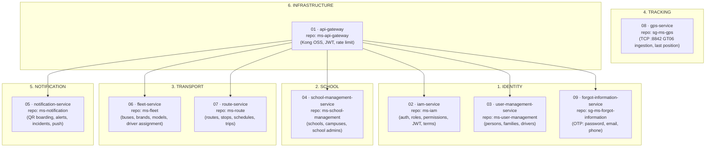

# Microservices Catalog

> **What to fill in here:** The complete inventory of system services grouped by business domain.
> For the detail of each service, go to `09-microservices/services/NN-service-name/`.
> This catalog is the executive view — one row per service.

> **Aligned with reality on 2026-10-22** against `backend/` (the code) and `database/`
> (the relational model, source of truth). Each row now carries the **real repository folder**
> and the **real SQL Server schema**, because the logical names used by the docs historically
> drifted from the code (`bus-service` → `ms-fleet`, `school-service` → `ms-school-management`).

---

## Business Domains & Services Map

---

## Service registry

> All services share a **single SQL Server instance / single database `school-guardian`**
> (ADR-002), each with its own schema for logical isolation. Foreign keys connect tables
> across schemas directly — that is the deployed reality and the reason the relational model
> is the source of truth. The API Gateway is the only stateless service (no datastore).
> All services listen on container port **8080** and are reached on the Docker network by
> service name; the ports below are the **published host ports**.

| # | Service (docs name) | Real repo | Domain | Main responsibility | Host port | Schema | Stack | Status |
|---|---------------------|-----------|--------|---------------------|-----------|--------|-------|--------|
| 01 | `api-gateway` | `ms-api-gateway` | Infra | Routing, JWT validation, rate limiting, CORS | 8000 | — | Kong OSS + Lua plugin `sg-jwt` | 🟢 Deployed (EC2) |
| 02 | `iam-service` | `ms-iam` | Identity | Identity, auth, roles/permissions (RBAC), profiles, sessions, terms | 8080 | `Iam` | Java 21 + Spring Boot 3 | 🟢 Deployed (EC2) |
| 03 | `user-management-service` | `ms-user-management` | Identity | Persons, families, family members, driver licenses | 8080 | `UserManagement` | C# + ASP.NET (hexagonal) | 🟢 Deployed (EC2) |
| 04 | `school-management-service` | `ms-school-management` | School | Schools, campuses, school admins | 8080 | `School` | C# + ASP.NET | 🟢 Deployed (EC2) |
| 05 | `notification-service` | `ms-notification` | Notifications | QR boarding/alighting, alerts, incidents, push (Expo) | **8081** | `Notification` | C# + ASP.NET | 🟢 Deployed (EC2) |
| 06 | `fleet-service` | `ms-fleet` | Transport | Bus fleet, brands, models, driver assignments | 8080 | `Fleet` | C# + ASP.NET | 🟢 Deployed (EC2) |
| 07 | `route-service` | `ms-route` | Transport | Routes, stops, schedules, executions/trips, assignments | 8080 | `Route` | C# + ASP.NET | 🟢 Deployed (EC2) |
| 08 | `gps-service` | `sg-ms-gps` | Tracking | GPS device ingestion (TCP :8842, GT06) and last position | 8080 (localhost) + **TCP 8842** | `Gps` | Java 21 + Spring Boot 3 | 🟡 In development (no persistence yet) |
| 09 | `forgot-information-service` | `sg-ms-forgot-information` | Identity | Password reset and email/phone change by OTP (SMTP + Twilio) | **8091** | `ForgotInformation` | C# + ASP.NET | 🟢 Deployed (EC2) |

**Statuses:** 🟢 Active in prod | 🟡 In development | 🔴 Planned | ⏸ Deprecated

> **Naming note:** `bus-service` (docs legacy) = **`fleet-service`** = repo `ms-fleet`,
> schema **`Fleet`** (not `Bus`). `school-service` (docs legacy) = **`school-management-service`**
> = repo `ms-school-management`, schema **`School`**. The `Geographic` schema (table `City`)
> is deployed via `database/ms-geographic-db` but **has no owning backend service**:
> `ms-school-management` and `ms-route` read it directly.

> **Data note (ADR-002):** All services share a **single SQL Server instance** (monolithic DB),
> each with its own schema for logical isolation. Foreign keys connect tables across schemas
> directly — the model currently has 20+ cross-schema FKs (e.g. `Iam.Profile.PersonId` →
> `UserManagement.Person`, `Notification.Alert.RouteExecutionId` → `Route.RouteExecution`).
> The API Gateway is stateless and owns no schema.

---

## Detail per service

### 01 — `api-gateway`

| Field | Value |
|-------|-------|
| **Folder** | `09-microservices/services/01-api-gateway/` |
| **Repo** | `ms-api-gateway` |
| **Domain** | Infrastructure |
| **Responsibility** | Single entry point. Routes, authenticates (JWT RS256 via JWKS), rate limiting, CORS |
| **Type** | Infrastructure service (not domain) |
| **Stack** | Kong OSS + custom Lua plugin `sg-jwt` |
| **Port** | 8000 (proxy) |
| **DB** | None (stateless, no datastore) |
| **Public routes** | `/api/v1/auth` (iam), `/user`, `/fleet`, `/school-management`, `/notification`, `/route`, `/api/v1/password` |
| **Externally exposed** | Yes — it is the only entry point |

**Key behavior:** strips inbound `X-User-*` headers and injects `X-User-Id`, `X-User-Role`,
`X-User-Email`, `X-User-Permissions`, `X-Campus-Id`, `X-School-Id`, `X-Correlation-Id`.
Anonymous paths: `/api/v1/auth`, `/api/v1/password`.

---

### 02 — `iam-service`

| Field | Value |
|-------|-------|
| **Folder** | `09-microservices/services/02-iam-service/` |
| **Repo** | `ms-iam` |
| **Domain** | Identity |
| **Responsibility** | Identity and access: login/refresh/logout, JWT RS256 + JWKS, roles/permissions (RBAC), profiles, sessions, terms acceptance |
| **Stack** | Java 21 + Spring Boot 3 (hexagonal) |
| **Schema** | `Iam` |
| **Tables** | Role, Permissions, PermissionsRole, Profile, SessionProfile, TermsAcceptance |
| **Direct FK Relationships** | `Profile.PersonId` → `UserManagement.Person(Id)`, `Profile.CampuseId` → `School.SchoolCampus(Id)`, `Profile.RoleId` → `Role(Id)`, `SessionProfile.ProfileId` → `Profile(Id)`, `TermsAcceptance.ProfileId` / `.StudentProfileId` → `Profile(Id)` |
| **gRPC server** | `usermanagement.v1.ProfileService` (`ProfileExists`, `GetDriverName`), `iam.v1.InternalProfileService` (`FindProfileByEmail`, `PhoneMatches`, `UpdatePassword`, `UpdateEmail`, `UpdatePhone`) |
| **Kafka** | produces `profile.created`; consumes `student.created`, `driver.created`, `admin.created`, `parent.created`, `admin.school.updated`, `user.status.changed` |
| **Consumed by** | api-gateway (JWKS), fleet, forgot-information, all services (JWT claims) |
| **Externally exposed** | Only through the API Gateway (`/api/v1/auth`) |

---

### 03 — `user-management-service`

| Field | Value |
|-------|-------|
| **Folder** | `09-microservices/services/03-user-management-service/` |
| **Repo** | `ms-user-management` |
| **Domain** | Identity |
| **Responsibility** | Persons, families, family members, driver licenses |
| **Stack** | C# + ASP.NET (hexagonal) |
| **Schema** | `UserManagement` |
| **Tables** | Person, Family, FamilyMember, DriverLicense |
| **Direct FK Relationships** | `FamilyMember.FamilyId` → `Family(Id)`, `FamilyMember.ProfileId` → `Iam.Profile(Id)`, `DriverLicense.ProfileId` → `Iam.Profile(Id)` |
| **gRPC server** | `family.FamilyService` (`RegisterFamilyGroup`, `GetFamilyMembersByStudent`) |
| **gRPC client** | `schoolmanagement.SchoolManagementService` (ms-school-management) |
| **Kafka** | produces `admin.created`, `driver.created`, `parent.created`, `student.created`, `admin.school.updated`, `user.status.changed` |

---

### 04 — `school-management-service`

| Field | Value |
|-------|-------|
| **Folder** | `09-microservices/services/04-school-service/` |
| **Repo** | `ms-school-management` |
| **Domain** | School |
| **Responsibility** | Schools (with campuses in one shot), campuses, school admins |
| **Stack** | C# + ASP.NET |
| **Schema** | `School` (reads `Geographic.City`) |
| **Tables** | School, SchoolCampus, SchoolAdmin |
| **Direct FK Relationships** | `School.CityId` → `Geographic.City(Id)`, `SchoolCampus.SchoolId` → `School(Id)`, `SchoolAdmin.SchoolId` → `School(Id)`, `SchoolAdmin.ProfileId` → `Iam.Profile(Id)` (UNIQUE — one admin = one school) |
| **gRPC server** | `schoolmanagement.SchoolManagementService` (`GetAdminSchool`, `GetCampus`, `GetCampusByName`, `LinkAdminSchool`, `GetSchool`) |

---

### 05 — `notification-service`

| Field | Value |
|-------|-------|
| **Folder** | `09-microservices/services/05-notification-service/` |
| **Repo** | `ms-notification` |
| **Domain** | Notifications |
| **Responsibility** | QR boarding/alighting scanning, alerts, alert types, recipients, incidents, push device tokens (Expo) |
| **Stack** | C# + ASP.NET |
| **Schema** | `Notification` |
| **Tables** | Boarding, Alert, AlertType, AlertRecipient, DeviceToken |
| **Direct FK Relationships** | `Boarding.RouteExecutionId` → `Route.RouteExecution(Id)`, `Boarding.ProfileId` → `Iam.Profile(Id)`, `Boarding.RouteStopId` → `Route.RouteStop(Id)`, `Alert.RouteExecutionId` → `Route.RouteExecution(Id)`, `Alert.AlertTypeId` → `AlertType(Id)`, `Alert.ProfileId` → `Iam.Profile(Id)`, `AlertRecipient.AlertId` → `Alert(Id)`, `AlertRecipient.ProfileId` → `Iam.Profile(Id)` |
| **gRPC clients** | `family.FamilyService` (ms-user-management), `route.RouteService` (ms-route) |
| **Kafka** | produces + consumes `student.scanned` and `incident.reported` |

> Incidents have **no dedicated table**: an incident is an `Alert` whose `AlertType` is an
> incident type (the 4 incident types are seeded in `database/ms-notification-db`), with the
> free text in `Alert.Description` (VARCHAR(500)).

---

### 06 — `fleet-service`

| Field | Value |
|-------|-------|
| **Folder** | `09-microservices/services/06-bus-service/` |
| **Repo** | `ms-fleet` |
| **Domain** | Transport |
| **Responsibility** | Bus fleet (create/edit/status), brands, models, driver assignment |
| **Stack** | C# + ASP.NET |
| **Schema** | `Fleet` |
| **Tables** | Bus, DriverAssignemts *(sic)*, Brand, Model |
| **Direct FK Relationships** | `Bus.CampuseId` → `School.SchoolCampus(Id)`, `Bus.GpsDeviceId` → `Gps.GpsDevice(Id)` (UNIQUE — 1:1 bus↔device), `Bus.ModelId` → `Model(Id)`, `DriverAssignemts.ProfileId` → `Iam.Profile(Id)`, `DriverAssignemts.BusId` → `Bus(Id)`, `Model.BrandId` → `Brand(Id)` |
| **gRPC server** | `route.v1.RouteService` (`GetBusAssignedToDriver`, `GetBusDetails`) |
| **gRPC client** | `usermanagement.v1.ProfileService` (ms-iam) |

---

### 07 — `route-service`

| Field | Value |
|-------|-------|
| **Folder** | `09-microservices/services/07-route-service/` |
| **Repo** | `ms-route` |
| **Domain** | Transport |
| **Responsibility** | Routes, stops, schedules, executions (trips), bus/student assignments |
| **Stack** | C# + ASP.NET |
| **Schema** | `Route` |
| **Tables** | Route, Stop, RouteStop, RouteBusAssignments, RouteStudentAssignments, RouteSchedule, RouteExecution |
| **Direct FK Relationships** | `Route.CampuseId` → `School.SchoolCampus(Id)`, `Stop.CityId` → `Geographic.City(Id)`, `Stop.SchoolId` → `School.School(Id)`, `RouteStop.RouteId` → `Route(Id)`, `RouteStop.StopId` → `Stop(Id)`, `RouteBusAssignments.BusId` → `Fleet.Bus(Id)`, `RouteBusAssignments.RouteId` → `Route(Id)`, `RouteStudentAssignments.ProfileId` → `Iam.Profile(Id)`, `RouteStudentAssignments.RouteStopId` → `RouteStop(Id)`, `RouteSchedule.RouteBusAssignmentsId` → `RouteBusAssignments(Id)`, `RouteExecution.BusId` → `Fleet.Bus(Id)`, `RouteExecution.DriverId` → `Iam.Profile(Id)`, `RouteExecution.RouteId` → `Route(Id)` |
| **gRPC server** | `route.RouteService` (15 rpc, consumed by ms-notification) |
| **gRPC client** | `route.v1.RouteService` (ms-fleet) |
| **External** | OSRM public API for route suggestions |

---

### 08 — `gps-service`

| Field | Value |
|-------|-------|
| **Folder** | `09-microservices/services/08-gps-service/` |
| **Repo** | `sg-ms-gps` |
| **Domain** | Tracking |
| **Responsibility** | GPS device ingestion (GT06-style protocol over TCP :8842) and last known position per IMEI |
| **Stack** | Java 21 + Spring Boot 3 (hexagonal) |
| **Schema** | `Gps` (owned by `database/ms-gps-db`; **not yet written by this service**) |
| **Tables** | GpsDevice, GpsLocation |
| **Direct FK Relationships** | `GpsLocation.GpsDeviceId` → `GpsDevice(Id)` |
| **REST** | `GET /api/gps/devices/{imei}`, `GET /api/gps/devices/{imei}/connected`, `GET /api/gps/devices/{imei}/location`, `POST /api/gps/test/{imei}` |

> **Open gap (FR-6.1/6.2/6.3):** positions live in an in-memory `ConcurrentHashMap`;
> `GpsLocationRepository` has no persistence adapter, so `Gps.GpsLocation` stays empty.
> There is no streaming endpoint for the map and no signal-loss alert yet.
> Devices are registered from `ms-fleet` (bus creation) into `Gps.GpsDevice`.

---

### 09 — `forgot-information-service`

| Field | Value |
|-------|-------|
| **Folder** | `09-microservices/services/12-forgot-information/` |
| **Repo** | `sg-ms-forgot-information` |
| **Domain** | Identity |
| **Responsibility** | Self-service recovery: password reset, email change and phone change, all by OTP |
| **Stack** | C# + ASP.NET |
| **Schema** | `ForgotInformation` |
| **Tables** | VerificationRequest |
| **Direct FK Relationships** | none (references `Iam.Profile` by convention only; no FK constraint) |
| **gRPC client** | `iam.v1.InternalProfileService` (ms-iam) |
| **Delivery channels** | SMTP :587 (email OTP), Twilio (SMS OTP) |
| **Security** | Fully anonymous by design: the OTP is the authenticator. Per-IP rate limit 10/min + per-profile authoritative limiter. Codes are hashed with `Otp:HashPepper` |

> Only `/api/v1/password` is routed through Kong. The email/phone change endpoints
> (`/api/v1/email/change/*`, `/api/v1/phone/change/*`) have **no gateway route** yet.

---

## Service communication matrix

> **Channels:** synchronous **gRPC** (ADR-005) and asynchronous **Kafka** (ADR-004).
> Client-facing REST goes only through the Kong gateway. gRPC internal calls between
> ms-fleet / ms-iam / sg-ms-forgot-information are guarded by the shared `x-internal-api-key`.

| Source service | Destination service | Channel | Type | Description |
|----------------|--------------------|---------|------|-------------|
| api-gateway | iam-service | HTTP/REST | Synchronous | Fetch JWKS to validate the RS256 JWT on every request |
| fleet-service | iam-service | gRPC | Synchronous | `ProfileExists`, `GetDriverName` (driver assignment) |
| route-service | fleet-service | gRPC | Synchronous | `GetBusAssignedToDriver`, `GetBusDetails` |
| user-management-service | school-management-service | gRPC | Synchronous | `GetCampus`, `GetCampusByName`, `LinkAdminSchool`, `GetSchool` |
| user-management-service | iam-service | Kafka | Asynchronous | `admin/driver/parent/student.created`, `admin.school.updated`, `user.status.changed` |
| iam-service | (its own consumer) | Kafka | Asynchronous | Creates the login `Profile` on `*.created`; mirrors account status |
| notification-service | user-management-service | gRPC | Synchronous | `GetFamilyMembersByStudent` — guardians of the students on board |
| notification-service | route-service | gRPC | Synchronous | Student stop, current trip, route detail for alert wording |
| notification-service | notification-service | Kafka | Asynchronous | `student.scanned` and `incident.reported` (producer + consumer → push) |
| forgot-information-service | iam-service | gRPC | Synchronous | `FindProfileByEmail`, `PhoneMatches`, `UpdatePassword`, `UpdateEmail`, `UpdatePhone` |

**Kafka topics in use:** `student.created`, `driver.created`, `admin.created`,
`parent.created`, `profile.created`, `admin.school.updated`, `user.status.changed`,
`student.scanned`, `incident.reported`.
(Only the first seven are pre-created in `backend/kafka/init/topics.conf`; the rest rely on
broker auto-creation.)

---

## Data ownership matrix

Each business entity has a single owner service.
Others access via API or events, never directly to the DB.

| Entity / Data | Schema | Owner service (Source of Truth) | How other services access |
|---------------|--------|--------------------------------|--------------------------|
| Profile, Role, Permissions, PermissionsRole, SessionProfile, TermsAcceptance | `Iam` | iam-service | REST API + internal gRPC |
| Person, Family, FamilyMember, DriverLicense | `UserManagement` | user-management-service | REST API + gRPC + events |
| School, SchoolCampus, SchoolAdmin | `School` | school-management-service | REST API + gRPC |
| City | `Geographic` | *(no backend owner — deployed via `ms-geographic-db`)* | direct read (school, route) |
| Bus, DriverAssignemts, Brand, Model | `Fleet` | fleet-service | REST API + gRPC |
| Route, Stop, RouteStop, RouteBusAssignments, RouteStudentAssignments, RouteSchedule, RouteExecution | `Route` | route-service | REST API + gRPC |
| Boarding, Alert, AlertType, AlertRecipient, DeviceToken | `Notification` | notification-service | REST API + consumed events |
| GpsDevice, GpsLocation | `Gps` | gps-service *(GpsDevice rows are currently written by fleet-service on bus creation)* | REST query |
| VerificationRequest | `ForgotInformation` | forgot-information-service | none (owns it privately) |

---

## Correlations

- Architecture and patterns → `05-architecture/`
- API contracts per service → `07-api/contracts/openapi/`
- System events → `02-domain/domain-events.md`
- Template for creating services → `09-microservices/_template/service/`
- Full detail per service → `09-microservices/services/NN-[name]/`
- Relational model (source of truth) → `06-data/models.md`
