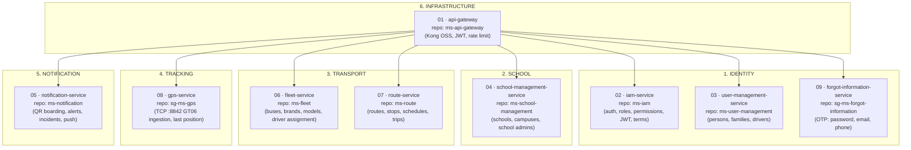

# Microservices Catalog

> **What to fill in here:** The complete inventory of system services grouped by business domain.
> For the detail of each service, go to `09-microservices/services/NN-service-name/`.
> This catalog is the executive view — one row per service.

> **Code/configuration alignment: 2026-10-27.** Eight backend services (six .NET 10,
> two Java 21) plus Kong = nine catalog entries; Kafka, SQL Server and historical
> configuration/exception/audit proposals are not additional backend services.
> Evidence is from the primary `Proyecto/sg-ms-*` repositories and `Proyecto/kafka`,
> not the divergent gateway/user copies under `schoo-guardian/backend`.
> Rows retaining `ms-*` names use runtime/legacy aliases; the primary repository
> folders are `sg-ms-api-gateway`, `sg-ms-iam`, `sg-ms-user-management`,
> `sg-ms-school-management`, `sg-ms-notification`, `sg-ms-fleet`, `sg-ms-route`,
> `sg-ms-gps` and `sg-ms-forgot-information`. Code and manifests do not prove
> production activity, installed schemas, host bindings or successful delivery.

---

## Business Domains & Services Map

---

## Service registry

> The persistence design uses one SQL Server database `school-guardian` with logical
> schemas and cross-schema foreign keys (ADR-002); live installation was not inspected.
> GPS keeps device/location state in memory, despite the SQL model's `Gps` tables.
> Kong has no datastore. HTTP upstreams are configured at container port **8080**;
> the host ports below are previously documented bindings, **not verified listeners**.

| # | Service (docs name) | Real repo | Domain | Main responsibility | Host port | Schema | Stack | Status |
|---|---------------------|-----------|--------|---------------------|-----------|--------|-------|--------|
| 01 | `api-gateway` | `sg-ms-api-gateway` | Infra | Routing, JWT validation, scoped rate limiting, CORS | 8000 | — | Kong OSS + Lua plugin `sg-jwt` | Configuration inspected; deployment unverified |
| 02 | `iam-service` | `sg-ms-iam` | Identity | Identity, auth, roles/permissions, profiles, sessions, terms | 8080 | `Iam` | Java 21 + Spring Boot 4.1.1 | Code inspected; deployment unverified |
| 03 | `user-management-service` | `sg-ms-user-management` | Identity | Persons, families, family members, driver licenses | 8080 | `UserManagement` | .NET 10 + ASP.NET | Code inspected; deployment unverified |
| 04 | `school-management-service` | `sg-ms-school-management` | School | Schools, campuses, school admins | 8080 | `School` | .NET 10 + ASP.NET | Code inspected; deployment unverified |
| 05 | `notification-service` | `sg-ms-notification` | Notifications | QR boarding/alighting, alerts, incidents, push attempts | **8081** | `Notification` | .NET 10 + ASP.NET | Code inspected; delivery/deployment unverified |
| 06 | `fleet-service` | `sg-ms-fleet` | Transport | Buses, brands, models, driver assignments | 8080 | `Fleet` | .NET 10 + ASP.NET | Code inspected; deployment unverified |
| 07 | `route-service` | `sg-ms-route` | Transport | Routes, stops, schedules, trips, assignments | 8080 | `Route` | .NET 10 + ASP.NET | Code inspected; deployment unverified |
| 08 | `gps-service` | `sg-ms-gps` | Tracking | TCP :8842 ingestion and last position in memory | 8080 (localhost) + **TCP 8842** | `Gps` (model only) | Java 21 + Spring Boot 4.1.1 | Memory implementation; deployment unverified |
| 09 | `forgot-information-service` | `sg-ms-forgot-information` | Identity | Password reset and email/phone change by OTP | **8091** | `ForgotInformation` | .NET 10 + ASP.NET | Code inspected; channels/deployment unverified |

**Status scope:** source/configuration observations only; earlier “Deployed (EC2)” labels were not runtime evidence.

> **Naming note:** `bus-service` (docs legacy) = **`fleet-service`** = repo `ms-fleet`,
> schema **`Fleet`** (not `Bus`). `school-service` (docs legacy) = **`school-management-service`**
> = repo `ms-school-management`, schema **`School`**. The `Geographic` schema (table `City`)
> is defined via `database/ms-geographic-db` but **has no owning backend service**:
> `ms-school-management` and `ms-route` read it directly.

> **Data note (ADR-002):** All services share a **single SQL Server instance** (monolithic DB),
> each with its own schema for logical isolation. Foreign keys connect tables across schemas
> directly — the model currently has 20+ cross-schema FKs (e.g. `Iam.Profile.PersonId` →
> `UserManagement.Person`, `Notification.Alert.RouteExecutionId` → `Route.RouteExecution`).
> The API Gateway is stateless and owns no schema.

---

## Detail per service

### 01 — `api-gateway`

| Field | Value |
|-------|-------|
| **Folder** | `09-microservices/services/01-api-gateway/` |
| **Repo** | `ms-api-gateway` |
| **Domain** | Infrastructure |
| **Responsibility** | Single entry point. Routes, authenticates (JWT RS256 via JWKS), rate limiting, CORS |
| **Type** | Infrastructure service (not domain) |
| **Stack** | Kong OSS + custom Lua plugin `sg-jwt` |
| **Port** | 8000 (proxy) |
| **DB** | None (stateless, no datastore) |
| **Configured proxy paths** | `/api/v1/auth`, `/.well-known/jwks.json`, `/user`, `/fleet`, `/school-management`, `/notification`, `/route`, `/trip`, `/api/v1/password`, `/api/v1/email/change`, `/api/v1/phone/change`, `/api/gps` |
| **External exposure** | Intended client entry point; actual network exposure not inspected |

**Key behavior:** strips inbound `X-User-*` headers and injects `X-User-Id`, `X-User-Role`,
`X-User-Email`, `X-User-Permissions`, `X-Campus-Id`, `X-School-Id`, `X-Correlation-Id`.
Public-list entries are `/api/v1/auth/login`, `/api/v1/auth/refresh`,
`/api/v1/auth/logout`, `/api/v1/auth/health`, `/api/v1/password` and
`/.well-known/jwks.json`. The plugin compares **prefixes**, not strictly exact
paths (`handler.lua:79–85`); the entire auth namespace is not public.
Auth profile/terms, business routes, GPS and email/phone changes require an access
token at the edge. GPS/JWKS/auth/recovery retain paths; business aliases strip
their proxy prefixes. Shared explicit-origin CORS allows credentials and declared
methods/headers; it is not authorization. JWT code has no explicit OPTIONS bypass:
preflight/plugin ordering requires runtime verification, not an assumed failure.
IAM limit: 300/min per Authorization header; login: 20/min and 200/h per IP.

---

### 02 — `iam-service`

| Field | Value |
|-------|-------|
| **Folder** | `09-microservices/services/02-iam-service/` |
| **Repo** | `ms-iam` |
| **Domain** | Identity |
| **Responsibility** | Identity and access: login/refresh/logout, JWT RS256 + JWKS, roles/permissions (RBAC), profiles, sessions, terms acceptance |
| **Stack** | Java 21 + Spring Boot 4.1.1 (POM declaration) |
| **Schema** | `Iam` |
| **Tables** | Role, Permissions, PermissionsRole, Profile, SessionProfile, TermsAcceptance |
| **Direct FK Relationships** | `Profile.PersonId` → `UserManagement.Person(Id)`, `Profile.CampuseId` → `School.SchoolCampus(Id)`, `Profile.RoleId` → `Role(Id)`, `SessionProfile.ProfileId` → `Profile(Id)`, `TermsAcceptance.ProfileId` / `.StudentProfileId` → `Profile(Id)` |
| **gRPC server** | `usermanagement.v1.ProfileService` (`ProfileExists`, `GetDriverName`), `iam.v1.InternalProfileService` (`FindProfileByEmail`, `PhoneMatches`, `UpdatePassword`, `UpdateEmail`, `UpdatePhone`) |
| **Kafka** | produces `profile.created`; consumes `student.created`, `driver.created`, `admin.created`, `parent.created`, `admin.school.updated`, `user.status.changed` |
| **Consumed by** | api-gateway (JWKS), fleet, forgot-information, all services (JWT claims) |
| **Externally exposed** | Only through the API Gateway (`/api/v1/auth`) |

---

### 03 — `user-management-service`

| Field | Value |
|-------|-------|
| **Folder** | `09-microservices/services/03-user-management-service/` |
| **Repo** | `ms-user-management` |
| **Domain** | Identity |
| **Responsibility** | Persons, families, family members, driver licenses |
| **Stack** | C# + ASP.NET (hexagonal) |
| **Schema** | `UserManagement` |
| **Tables** | Person, Family, FamilyMember, DriverLicense |
| **Direct FK Relationships** | `FamilyMember.FamilyId` → `Family(Id)`, `FamilyMember.ProfileId` → `Iam.Profile(Id)`, `DriverLicense.ProfileId` → `Iam.Profile(Id)` |
| **gRPC server** | `family.FamilyService` (`RegisterFamilyGroup`, `GetFamilyMembersByStudent`) |
| **gRPC client** | `schoolmanagement.SchoolManagementService` (ms-school-management) |
| **Kafka** | produces `admin.created`, `driver.created`, `parent.created`, `student.created`, `admin.school.updated`, `user.status.changed` |

---

### 04 — `school-management-service`

| Field | Value |
|-------|-------|
| **Folder** | `09-microservices/services/04-school-service/` |
| **Repo** | `ms-school-management` |
| **Domain** | School |
| **Responsibility** | Schools (with campuses in one shot), campuses, school admins |
| **Stack** | C# + ASP.NET |
| **Schema** | `School` (reads `Geographic.City`) |
| **Tables** | School, SchoolCampus, SchoolAdmin |
| **Direct FK Relationships** | `School.CityId` → `Geographic.City(Id)`, `SchoolCampus.SchoolId` → `School(Id)`, `SchoolAdmin.SchoolId` → `School(Id)`, `SchoolAdmin.ProfileId` → `Iam.Profile(Id)` (UNIQUE — one admin = one school) |
| **gRPC server** | `schoolmanagement.SchoolManagementService` (`GetAdminSchool`, `GetCampus`, `GetCampusByName`, `LinkAdminSchool`, `GetSchool`) |

---

### 05 — `notification-service`

| Field | Value |
|-------|-------|
| **Folder** | `09-microservices/services/05-notification-service/` |
| **Repo** | `ms-notification` |
| **Domain** | Notifications |
| **Responsibility** | QR boarding/alighting scanning, alerts, alert types, recipients, incidents, push device tokens (Expo) |
| **Stack** | C# + ASP.NET |
| **Schema** | `Notification` |
| **Tables** | Boarding, Alert, AlertType, AlertRecipient, DeviceToken |
| **Direct FK Relationships** | `Boarding.RouteExecutionId` → `Route.RouteExecution(Id)`, `Boarding.ProfileId` → `Iam.Profile(Id)`, `Boarding.RouteStopId` → `Route.RouteStop(Id)`, `Alert.RouteExecutionId` → `Route.RouteExecution(Id)`, `Alert.AlertTypeId` → `AlertType(Id)`, `Alert.ProfileId` → `Iam.Profile(Id)`, `AlertRecipient.AlertId` → `Alert(Id)`, `AlertRecipient.ProfileId` → `Iam.Profile(Id)` |
| **gRPC clients** | `family.FamilyService` (ms-user-management), `route.RouteService` (ms-route) |
| **gRPC server** | `boarding.BoardingService.GetAlightedCountAtStop` (caller not located in this bounded trace) |
| **Kafka** | produces + consumes `student.scanned` and `incident.reported` |

> Incidents have **no dedicated table**: an incident is an `Alert` whose `AlertType` is an
> incident type (the 4 incident types are seeded in `database/ms-notification-db`), with the
> free text in `Alert.Description` (VARCHAR(500)).

---

### 06 — `fleet-service`

| Field | Value |
|-------|-------|
| **Folder** | `09-microservices/services/06-bus-service/` |
| **Repo** | `ms-fleet` |
| **Domain** | Transport |
| **Responsibility** | Bus fleet (create/edit/status), brands, models, driver assignment |
| **Stack** | C# + ASP.NET |
| **Schema** | `Fleet` |
| **Tables** | Bus, DriverAssignemts *(sic)*, Brand, Model |
| **Direct FK Relationships** | `Bus.CampuseId` → `School.SchoolCampus(Id)`, `Bus.GpsDeviceId` → `Gps.GpsDevice(Id)` (UNIQUE — 1:1 bus↔device), `Bus.ModelId` → `Model(Id)`, `DriverAssignemts.ProfileId` → `Iam.Profile(Id)`, `DriverAssignemts.BusId` → `Bus(Id)`, `Model.BrandId` → `Brand(Id)` |
| **gRPC server** | `route.v1.RouteService` (`GetBusAssignedToDriver`, `GetBusDetails`) |
| **gRPC client** | `usermanagement.v1.ProfileService` (ms-iam) |

---

### 07 — `route-service`

| Field | Value |
|-------|-------|
| **Folder** | `09-microservices/services/07-route-service/` |
| **Repo** | `ms-route` |
| **Domain** | Transport |
| **Responsibility** | Routes, stops, schedules, executions (trips), bus/student assignments |
| **Stack** | C# + ASP.NET |
| **Schema** | `Route` |
| **Tables** | Route, Stop, RouteStop, RouteBusAssignments, RouteStudentAssignments, RouteSchedule, RouteExecution |
| **Direct FK Relationships** | `Route.CampuseId` → `School.SchoolCampus(Id)`, `Stop.CityId` → `Geographic.City(Id)`, `Stop.SchoolId` → `School.School(Id)`, `RouteStop.RouteId` → `Route(Id)`, `RouteStop.StopId` → `Stop(Id)`, `RouteBusAssignments.BusId` → `Fleet.Bus(Id)`, `RouteBusAssignments.RouteId` → `Route(Id)`, `RouteStudentAssignments.ProfileId` → `Iam.Profile(Id)`, `RouteStudentAssignments.RouteStopId` → `RouteStop(Id)`, `RouteSchedule.RouteBusAssignmentsId` → `RouteBusAssignments(Id)`, `RouteExecution.BusId` → `Fleet.Bus(Id)`, `RouteExecution.DriverId` → `Iam.Profile(Id)`, `RouteExecution.RouteId` → `Route(Id)` |
| **gRPC server** | `route.RouteService` (16 RPCs; notification copy has 15, omitting `GetTripStatus`) |
| **gRPC clients** | `route.v1.RouteService` (ms-fleet), `family.FamilyService` (ms-user-management) |
| **External** | OSRM public API for route suggestions |

---

### 08 — `gps-service`

| Field | Value |
|-------|-------|
| **Folder** | `09-microservices/services/08-gps-service/` |
| **Repo** | `sg-ms-gps` |
| **Domain** | Tracking |
| **Responsibility** | GPS device ingestion (GT06-style protocol over TCP :8842) and last known position per IMEI |
| **Stack** | Java 21 + Spring Boot 4.1.1 (POM declaration) |
| **Schema** | `Gps` (owned by `database/ms-gps-db`; **not yet written by this service**) |
| **Tables** | GpsDevice, GpsLocation |
| **Direct FK Relationships** | `GpsLocation.GpsDeviceId` → `GpsDevice(Id)` |
| **REST** | `GET /api/gps/devices/{imei}`, `GET /api/gps/devices/{imei}/connected`, `GET /api/gps/devices/{imei}/location`, `POST /api/gps/test/{imei}` |

> **Open gap (FR-6.1/6.2/6.3):** positions live in an in-memory `ConcurrentHashMap`;
> no persistent write adapter was verified; this does not prove a live SQL table is empty.
> There is no streaming endpoint for the map and no signal-loss alert yet.
> Devices are registered from `ms-fleet` (bus creation) into `Gps.GpsDevice`.

---

### 09 — `forgot-information-service`

| Field | Value |
|-------|-------|
| **Folder** | `09-microservices/services/12-forgot-information/` |
| **Repo** | `sg-ms-forgot-information` |
| **Domain** | Identity |
| **Responsibility** | Self-service recovery: password reset, email change and phone change, all by OTP |
| **Stack** | C# + ASP.NET |
| **Schema** | `ForgotInformation` |
| **Tables** | VerificationRequest |
| **Direct FK Relationships** | none (references `Iam.Profile` by convention only; no FK constraint) |
| **gRPC client** | `iam.v1.InternalProfileService` (ms-iam) |
| **Delivery channels** | SMTP :587 (email OTP), Twilio (SMS OTP) |
| **Security** | No local JWT/global controller authorization; OTP plus 10/min per-IP and per-profile limits. Kong requires JWT for email/phone changes but not password recovery. Codes hashed with `Otp:HashPepper` |

> Kong declares all three recovery/change prefixes. Do not equate gateway JWT
> enforcement on email/phone changes with a local JWT barrier in this backend.

---

## Service communication matrix

> **Channels:** synchronous **gRPC** (ADR-005) and asynchronous **Kafka** (ADR-004).
> Client-facing REST goes only through the Kong gateway. gRPC internal calls between
> ms-fleet / ms-iam / sg-ms-forgot-information are guarded by the shared `x-internal-api-key`.

| Source service | Destination service | Channel | Type | Description |
|----------------|--------------------|---------|------|-------------|
| api-gateway | iam-service | HTTP/REST | Synchronous | Fetch/cache JWKS for RS256 validation; not a network fetch on every request |
| fleet-service | iam-service | gRPC | Synchronous | `ProfileExists`, `GetDriverName` (driver assignment) |
| route-service | fleet-service | gRPC | Synchronous | `GetBusAssignedToDriver`, `GetBusDetails` |
| user-management-service | school-management-service | gRPC | Synchronous | `GetCampus`, `GetCampusByName`, `LinkAdminSchool`, `GetSchool` |
| user-management-service | iam-service | Kafka | Asynchronous | `admin/driver/parent/student.created`, `admin.school.updated`, `user.status.changed` |
| iam-service | No consumer located | Kafka | Asynchronous | Publishes `profile.created`; incoming user events create profiles/update status |
| route-service | user-management-service | gRPC | Synchronous | `GetFamilyMembersByStudent` for guardian lookup |
| notification-service | user-management-service | gRPC | Synchronous | `GetFamilyMembersByStudent` — guardians of the students on board |
| notification-service | route-service | gRPC | Synchronous | Student stop, current trip, route detail for alert wording |
| notification-service | notification-service | Kafka | Asynchronous | `student.scanned` and `incident.reported` (producer + consumer → push) |
| forgot-information-service | iam-service | gRPC | Synchronous | `FindProfileByEmail`, `PhoneMatches`, `UpdatePassword`, `UpdateEmail`, `UpdatePhone` |

**Kafka topics in use:** `student.created`, `driver.created`, `admin.created`,
`parent.created`, `profile.created`, `admin.school.updated`, `user.status.changed`,
`student.scanned`, `incident.reported`.
All nine are declared in `Proyecto/kafka/init/topics.conf:6–20` (one partition,
replication factor one); broker creation/activity was not inspected.

### Verified authentication and integration limits (2026-10-27)

IAM signs access and refresh tokens with RS256 and `kid`, publishes public JWKS,
and issues `permissions`, `roleId`, tenant and token-type claims. RSA keys fall
back to an ephemeral pair if not configured. Defaults are 60-minute access /
7-day refresh; cookie is `HttpOnly`, `Secure`, `SameSite=None`, not `Strict`.
Each of fleet, route, school, users and notifications validates RS256/JWKS,
issuer, audience, lifetime and `type=access`, calls authentication/authorization
middleware and maps controllers with `RequireAuthorization`. `RequirePermission`,
`RequireRole` and `RequireProfile` add endpoint controls; these observations are
not an exhaustive authorization or tenant-isolation certification.

IAM's two gRPC services and fleet's gRPC server use an internal-key interceptor;
their clients supply `x-internal-api-key`. School, family, route and boarding
registrations inspected do not inherit REST controller authorization, and no
equivalent interceptor was verified there. Network/TLS/exposure remain untested.
Do not confuse `route.v1.RouteService` (fleet, 2 RPCs) with `route.RouteService`
(route backend, 16 RPCs). School has 5 RPCs, Family 2, IAM Profile 2 and
InternalProfile 5, Boarding 1. Peer contracts match the used RPC/message fields
apart from language options/comments; the notification route copy lacks the
additional server `GetTripStatus` RPC. No generated-client/network test was run.

| Topics / payload | Producer → consumer / group | Serialized fields |
|---|---|---|
| `student.created`, `driver.created`, `admin.created`, `parent.created` | users → IAM / `iam` | `EventId`, `PersonId`, `Email`, `IdentificationNumber`, `CampusId`, `SchoolId` |
| `admin.school.updated` | users → IAM / `iam` | `EventId`, `PersonId`, `SchoolId` |
| `user.status.changed` | users → IAM / `iam` | `EventId`, `PersonId`, `Email`, `Status` (text) |
| `profile.created` | IAM → no consumer located | `EventId`, `ProfileId`, `PersonId`, `RoleId` |
| `student.scanned` | notifications → notifications / `ms-notification-consumer` | `BoardingId`, `AlertId`, `StudentProfileId`, `RouteExecutionId`, `BoardingType`, `Timestamp`, `StopName`, `StopAddress`, `Latitude`, `Longitude` |
| `incident.reported` | notifications → notifications / `ms-notification-incident-consumer` | `AlertId`, `RouteExecutionId`, `ReportedByProfileId`, `AlertTypeId`, `Description`, `StudentsOnBoard`, `Recipients`, `Timestamp` |

.NET uses default `System.Text.Json` PascalCase/numeric enums; IAM maps PascalCase
with `JsonProperty`. Consumer reset is `earliest`. .NET awaits publication with
random GUID keys, not entity keys; IAM's `KafkaTemplate.send` does not await its
future. IAM handlers catch/log use-case failures; notification loops catch/log
errors without success-coupled manual commits. No transactional outbox, DLQ or
persistent `EventId` deduplication ledger was verified in these adapters.
Reliable retries, exactly-once processing and delivery are not guaranteed.
Profile creation rejects existing persons, not upserts. Scan duplicate protection
is by explicit boarding state, not request ID; omitted type toggles state.
Scan recipient insertion skips existing rows but push can repeat on replay;
incident push has no persistent replay ledger.

**Separate outcomes:** an alert persisted before publish ≠ an event processed ≠
a push send attempted ≠ a device delivery receipt. Incident recipients are
resolved best-effort before save; scan recipients are resolved by the consumer.
Missing directories/tokens can prevent push. Expo sends batches of 100 and logs
errors, without processing tickets or delivery receipts. `DateTimeRead` is set
at recipient creation, not proof of human reading. Neither successful API
responses nor Expo HTTP success prove receipt.

**Source evidence, relative to `Proyecto`:**
- Source revisions: gateway `510f28e`, IAM `5565af7`, GPS `3f1b33c`, fleet
  `b9fb6f8`, route `7fbef43`, school `45c719a`, users `1024870`, notification
  `43ac61b`, recovery `67e2764`, Kafka `895b43e`. Documentation bases:
  `sg-documentation` `720da66`, `sg-docs` `9c04966`.
- `sg-ms-iam/pom.xml:8,30`, `sg-ms-gps/pom.xml:11,23`: Boot 4.1.1 / Java 21.
- `sg-ms-iam/src/main/java/com/school_guardian/ms_iam/infrastructure/security/JwtTokenProvider.java:37–107`,
  `web/JwksController.java:21–23`, `security/RsaKeyProvider.java:29–49`,
  `web/RefreshCookieSupport.java:40–45` (the last three paths share the IAM infrastructure prefix).
- `sg-ms-api-gateway/kong/kong.yml:13–24,66–103,192–247`;
  `kong/plugins/sg-jwt/handler.lua:79–85,103–115` within that repository.
- `sg-ms-{fleet,route,school-management,user-management,notification}/src/*/Program.cs`
  and `Infrastructure/Auth/JwtAuthenticationExtensions.cs` (users uses
  `Shared/Infrastructure/Auth`); representative controls:
  fleet `BusController.cs:53–178`, route `TripController.cs:36–46`,
  school `SchoolController.cs:55–172`, users `StudentController.cs:35–95`,
  notification `ScanController.cs:24–25`.
- `sg-ms-forgot-information/src/ms-forgot-information.Api/Program.cs:118–131`
  and `EmailChange`/`PhoneChange/Infrastructure/Controller/*Controller.cs`.
- IAM `infrastructure/messaging/{PersonCreatedConsumer,PersonStatusChangedConsumer,KafkaDomainEventPublisher}.java`,
  `config/KafkaConsumerConfig.java`; users/notification `Infrastructure/Messaging/Kafka/KafkaEventPublisher.cs`;
  notification `Application/UseCase/{ProcessScanService.cs:153–175,ReportIncidentService.cs:101–108}`,
  `Infrastructure/Messaging/Kafka/Consumer/*.cs`,
  `Infrastructure/Messaging/Push/ExpoPushNotifier.cs:49–81`.
- Per-service `Protos/*.proto` and IAM `src/main/proto/*.proto`, gRPC server/client
  registrations, IAM `GrpcServerLifecycle.java:53–57`, fleet interceptor registration.

This is bounded source alignment, not a complete audit. Production images,
effective keys/policies, broker offsets/replay, TLS, isolation and actual
SMTP/Twilio/Expo/device delivery were not exercised; no secrets or production
endpoints were read.

---

## Data ownership matrix

Each business entity has a logical owner. API/event-only access is a design
boundary, **not universally implemented**: notification's `StudentDirectory`
reads `Iam.Profile` and `UserManagement.Person`, and `SchoolDirectory` joins
`Iam.Profile`, `School.SchoolCampus` and `School.SchoolAdmin`
(`Infrastructure/Persistence/Context/NotificationContext.cs:49–64` and
`Directory/SchoolDirectory.cs:28–38`). Route's `TripBoardingQueryRepository.cs:41–54`
attempts an EF query with a zero-on-error fallback, not the available Boarding
RPC. Its successful mapping/execution was not established. These are source
observations, not a database-access or isolation audit.

| Entity / Data | Schema | Owner service (Source of Truth) | How other services access |
|---------------|--------|--------------------------------|--------------------------|
| Profile, Role, Permissions, PermissionsRole, SessionProfile, TermsAcceptance | `Iam` | iam-service | REST API + internal gRPC |
| Person, Family, FamilyMember, DriverLicense | `UserManagement` | user-management-service | REST API + gRPC + events |
| School, SchoolCampus, SchoolAdmin | `School` | school-management-service | REST API + gRPC |
| City | `Geographic` | *(no backend owner — deployed via `ms-geographic-db`)* | direct read (school, route) |
| Bus, DriverAssignemts, Brand, Model | `Fleet` | fleet-service | REST API + gRPC |
| Route, Stop, RouteStop, RouteBusAssignments, RouteStudentAssignments, RouteSchedule, RouteExecution | `Route` | route-service | REST API + gRPC |
| Boarding, Alert, AlertType, AlertRecipient, DeviceToken | `Notification` | notification-service | REST API + consumed events |
| GpsDevice, GpsLocation | `Gps` | gps-service *(GpsDevice rows are currently written by fleet-service on bus creation)* | REST query |
| VerificationRequest | `ForgotInformation` | forgot-information-service | none (owns it privately) |

---

## Correlations

- Architecture and patterns → `05-architecture/`
- API contracts per service → `07-api/contracts/openapi/`
- System events → `02-domain/domain-events.md`
- Template for creating services → `09-microservices/_template/service/`
- Full detail per service → `09-microservices/services/NN-[name]/`
- Relational model (source of truth) → `06-data/models.md`
